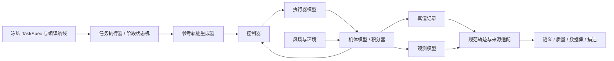

# 快速无人机动力学引擎：评估与实现计划

状态：**融合修订版 r2；M0/M1 已本地实现，M0/M1 最终本地验收已通过，M2–M5 尚未实施**。日期：2026-10-12。原源码评估基线：`5e45637f2bf63054ed0ace2433fd7c9ea7b075ac`，新实现未提交并另存内容哈希。此 r2 是计划修订号，与历史 SITL 生产批次 r2 无关。

新窗口从 [本地开发交接](fast_dynamics_engine_kickoff.md) 和 [M0/M1 实施报告](fast_dynamics_engine_m01_report.md)进入，核对首包最终验收后推进下一包 M2；环境、代码地图、历史状态、测试入口及实施登记由交接文件维护。用户当前要求仅本地实现与验证，暂不提交、推送、建 PR 或打标签。远端 CI/发布不作为本地里程碑的推进门槛。

本文保留原评估和 M0–M5 计划正文，设计要求不能整体当作已具备能力。当前已实现 M0 适配/来源登记及 M1 确定性内核、双机快速通过完整链路，独立协议为 `fast_dynamics_v1` / `sim_clock`，详情见[适配备忘](fast_dynamics_engine_adapter_memo.md)与实施报告。完整任务覆盖、确定性校准、扰动、两种生产模式和独立研究验收仍属后续计划；性能目标也未因首包样本通过而达成。本计划不改变 T1/T4 通过、T5 失败、T6 未运行的历史结论，也不启动或准备 r3。

本版吸收用户提供的 Claude `fastsim_plan.md` 及其讨论中的短设计备忘、早期端到端样本、未校准基线、分阶段校准和两类数据用途。它们是设计参考，本文与当前用户要求构成本地实施依据；不沿用其中已过时的“r3 正在收尾”、强制 worktree、等待 r3 或提交/推送要求。开发使用 `Simulation-dev`，保留现有未提交文档。

| 融合决定 | 本版落实位置 |
| --- | --- |
| 先摸清接入，再用最小模型跑通真实数据链 | M0 适配表、M1 单机内核 + 最小双机端到端样本；不等到 M4 才接导出/加载 |
| 先确定性动力学，后观测扰动 | M3 保存无新增扰动的校准前后对照，M4 再增加可控随机条件 |
| 按路径进度比较形状，单独比较时间 | §6.2 的阶段/圈次约束弧长匹配及独立时序指标 |
| 修正校准/留出泄漏 | T1/T4 同源 42 任务、14 family 统一归入开发；来源合并去重后再划分 |
| 保留升级空间，按需增加实现 | §4 的接口是边界；首包仅实现被调用的组件，未来刚体/电机接口不做空框架 |
| 支持两种数据用途 | §5.3 的带标签与无标注模式；共享来源、质量与划分规则 |

## 1. 结论与适用范围

建议新增 **Python + NumPy 的离线任务级动力学后端**，第一版采用带加速度、加加速度限制的三维运动模型。复用任务生成、场景 family、航线及语义规则，通过独立适配层接入数据产品。SITL 保留为校准来源及跨仿真器测试域。

该方案适合当前 Traj2Language 的第一阶段：输入是多机位置、速度、有效性掩码和公开目标区域，研究任务是轨迹语义与语言对齐。第一版重点再现加减速、转弯、驻留、跟踪滞后、多机相对时序和观测不完整性。不能由此宣称飞控控制器、真实 IMU、电机或真实飞机得到验证。

三个分别成立的目标：

1. **研究正确性**：时间、坐标、轨迹、标签、描述及数据划分一致；真实执行失败可以成为有效样本，生成器出错不能伪装成任务失败。
2. **可用的运动分布**：通过校准及独立评估，证明简化模型没有依赖不合理的直角瞬时转弯、匀速瞬时启停或标签专属噪声。
3. **生产效率**：实测包括模拟、分析、描述、哈希和写盘的完整吞吐；不能只用积分内核速度推算整个数据集工期。

当前 T4 稳态合格吞吐约 46.48 episode/小时；T5 的失败与局部接收时钟比值越界有关。统一仿真时钟可以消除这条接收时间桥接依赖，但新后端仍需验证数值积分、控制行为和观测模型。

### 1.1 方案比较

| 方案 | 优点 | 工作与局限 | 结论 |
| --- | --- | --- | --- |
| Python 运动模型 + 简化控制器 | 易接现有任务和数据代码；可确定性运行；直接表达当前六维输入 | 需校准响应和观测误差；第一版不产生物理完整姿态/IMU | **第一版采用** |
| 自写 C++ 六自由度刚体 | 可覆盖姿态、角速度、力和力矩 | 控制器、电机、积分和坐标验证工作更大；高性能不等于高保真 | 作为后续模型升级，按实际需求启动 |
| 接入现有 PyBullet 等框架 | 已有刚体和碰撞能力，可用于外部交叉验证 | 仍需任务、控制器、数据契约适配；Windows 依赖和吞吐需实测 | 接口预留，暂不成为 MVP 依赖 |

PX4 将速度、加速度与 jerk 约束用于多旋翼轨迹生成，支持将这些量作为任务级近似的设计依据；本计划不复制 PX4 参数或宣称与其控制器等价。[PX4 轨迹约束说明](https://docs.px4.io/main/en/config_mc/mc_jerk_limited_type_trajectory)

`gym-pybullet-drones` 提供多旋翼控制与下洗示例，可作为以后刚体模型和外部后端的参考；其现有平台说明不能代替本项目的 Windows 验证。[项目源码与说明](https://github.com/learnsyslab/gym-pybullet-drones)

## 2. 现有代码评估及复用边界

下表来自实际源码检查，架构文档的旧状态说明不作为当前执行状态依据。

| 模块 | 当前实际耦合 | 新引擎接入方式 |
| --- | --- | --- |
| `generation.py`、`generation_v2.py`、`families.py` | 已有场景采样、整族接受和哈希划分 | 复用；引擎参数另存，保持源任务 bundle 不变 |
| `registry.py`、`mission_v3.py` | IntentSpec / PlannerSpec / PlanResult，三个意图及四种飞法 | 复用编译输出；对缺少的能力显式报不支持 |
| `runner_v3.py`、`vehicle.py`、`processes.py` | MAVLink、起降、阶段屏障、主机等待、SITL 进程 | 新建离线执行器；不在原飞控循环中加入大量后端分支 |
| `analysis_v3.py`、`truth.py`、`time_contract.py` | 原始包、BIN、参考机、被动时钟映射、固件证据 | 新建规范轨迹适配入口，直接使用共同仿真时钟 |
| `mission_evaluation_v3.py`、各意图验证器 | 几何语义可复用，但函数内仍有 SIM/FCU 来源文字和事件窗口假设 | 提取/适配中立输入与来源描述；保留原意图阈值和三态结果 |
| `route_windows.py` | 观测用 FCU 水平速度；真值用相邻位置差分和可选时钟 | 显式声明通道的时间和速度来源；第一版保持原几何算法，不假造时钟模型 |
| `quality.py`、`protocol.py`、`validation_policy*.py` | 合格条件绑定 clock_quality、parameter_firmware_check、机载参数附件 | 新后端独立质量策略和来源校验；旧规则继续按旧协议执行 |
| `parallel_batch.py`、`parallel_worker.py` | 固件、参数文件、端口、SITL worker 和产物清单强绑定 | 先独立快速批处理适配器；复用能证明无耦合的台账/哈希工具，后续再抽公共调度内核 |
| `dataset.py`、`dataset_audit.py`、`episode_loader.py` | 六维输入可复用，但协议及附件校验不能仅靠同名 CSV 绕过 | 注册新产物协议；默认拒绝静默混合后端数据 |
| `observer_facts_v0.py`、`language_v0.py` | 事实生成依赖质量、双通道核验及来源版本 | 复用语义词汇与模板，新增事实来源版本，逐句核验依据 |

**主要工程难点是契约和验收适配，不是积分公式。** 当前 `quality.episode_quality_eligibility()` 对 `sim_source` 要求固件证据通过；`parallel_worker._inputs()` 会检查固件哈希、参数和端口。给新引擎填假的“固件通过”或“时钟严格合格”不可接受。

第一版仍生成当前三种意图和四种飞法，不同时扩充新战术、避障规划器或语言模板，以便定位后端替换带来的影响。

M0 的短设计备忘以一张适配表为核心：逐项列出任务/航线输入、实际状态与事件、下游消费者、所需单位/时间、已有耦合和最小改动。附一个任务的具体字段映射，明确哪些字段直接复用、哪些转换、哪些不适用及哪些是新后端必须提供的证据。沿真实 analyze/export/audit/describe/load 依赖核对，不能只检查 CSV 列名。

允许对公共接口作最小、显式、按协议分派的适配，并以回归证明 SITL 行为不变；“行为兼容”不等于任何公共文件都不能修改。几何阈值、标签定义和描述事实逻辑保持当前含义。若接入要求改变这些研究语义，则先记录原因及影响，不能为使 fastsim 通过而自行放宽。

## 3. 第一版模型：范围、方程与数值实现

### 3.1 状态与控制

每架飞机核心状态为 ENU 位置 \(\mathbf p\)、速度 \(\mathbf v\)、净平动加速度 \(\mathbf a\)。这里的 \(\mathbf a\) 是有效闭环响应状态，**不是原始加速度计读数**。必要时保存标量偏航用于显示/引导，但没有旋转动力学时不输出“真实滚转、俯仰、机体角速度或 IMU”。

参考轨迹可提供 \((\mathbf p_d,\mathbf v_d,\mathbf a_d)\)。以下为可选的位置/速度反馈扩展形式；M1 默认的更小速度响应模型在公式后定义：

\[
\mathbf a_c=\Pi_{\mathcal A}\left[\mathbf a_d+K_p(\mathbf p_d-\mathbf p)
+K_v(\mathbf v_d-\mathbf v)+\mathbf d_{wind}\right],\qquad
\mathbf j_c=\operatorname{limit}\left((\mathbf a_c-\mathbf a)/\tau_a,\ j_{max}\right).
\]

\(\mathcal A\) 是水平、上升、下降能力构成的可行加速度集合；\(\tau_a\) 是响应时间；\(\mathbf d_{wind}\) 第一版是明确标注的等效平动扰动。它不声称复现旋翼气动。

上述位置/速度反馈是候选扩展形式。**M1 优先实现更少参数的速度响应模型**：由航线跟踪器产生 \(\mathbf v_d\)，令 \(\mathbf a_c=\Pi_{\mathcal A}[(\mathbf v_d-\mathbf v)/\tau_v]\)，再通过同一加速度/jerk 约束和积分器执行。jerk 限制需要保存实际加速度，不能只有位置/速度而丢弃上一时刻加速度。先固定一个控制版本，只有开发集显示明确的跟踪缺陷时才加入位置反馈或前馈，不同时拟合多个作用相近的增益与时间常数。M1–M3 的风与新增过程/观测噪声关闭。

步内用常 jerk 多项式更新：

\[
\begin{aligned}
\mathbf a_{k+1}&=\mathbf a_k+\mathbf j_k h,\\
\mathbf v_{k+1}&=\mathbf v_k+\mathbf a_k h+\tfrac12\mathbf j_kh^2,\\
\mathbf p_{k+1}&=\mathbf p_k+\mathbf v_kh+\tfrac12\mathbf a_kh^2+\tfrac16\mathbf j_kh^3.
\end{aligned}
\]

\(\mathbf j_k\) 还须满足 \(\mathbf a_k+\mathbf j_kh\in\mathcal A\)；对凸能力集合保证整步加速度可行。实现者必须同时验证 jerk 和加速度约束，不能先限 jerk、再直接裁剪速度/位置而破坏运动学一致性。

速度上限主要由参考生成和提前刹车实现。实际动态超限记录为约束结果；不能瞬间截断 \(\mathbf v\) 来伪造通过。质量和控制能力分别定义，以免把正常跟踪误差等同引擎错误。

### 3.2 航线跟踪与阶段执行

- 使用现有编译航线，明确中间航点的连续经过语义和阶段终点的到达/驻留语义。
- 连续转弯采用有限前视距离、曲率限速和加减速前瞻；靠近必须停止的端点按剩余距离提前刹车。不得在每个内部航点默认悬停。
- 初始前瞻可参考 \(v_d\le\sqrt{v_{exit}^2+2a_{brake}d}\)，但该式仅覆盖恒加速度理想刹车；实际还受当前加速度、jerk 和响应延迟影响，必须通过前向预测或经测试的刹车余量修正。先用接受半径、转角/曲率限速和直线段前瞻实现，开发证据不足时才增加样条。不能仅改变目标速度方向却声称实际转弯半径已经受控。
- 圆角/前视不能切出任务允许走廊；过弯造成的真实覆盖损失、间距下降应进入评估，而非由规划结果补回。
- 提取现有阶段释放、相对出发偏移、返航及最终驻留的含义，写成显式仿真状态机；phase ready / release / arrival / hold end 各有来源事件。
- 阶段“到达”由实际状态和既定容差判定；名义到达时间只作诊断。
- 第一个里程碑从已稳定的空中状态开始，声明 `lifecycle_scope=airborne_mission`；不生成假的起飞/降落证据。任务进出场仍保留；起降模型在后续单独增加。
- 首版不自动增加避碰控制。保留间距检查；若以后加入避碰，其策略版本、介入事件与语义影响必须可追踪。

### 3.3 时间与同步

内部步长比较 \(h=0.02\) 与 \(0.01\) 仿真秒；默认候选为 0.02 秒、参考/控制频率 50 Hz，输出固定 10 Hz。先做收敛与性能比较，再冻结步长；需要时继续减半。时间基座采用整数微秒或整数 tick，禁止不断浮点累加决定输出帧数。控制/物理步长与输出周期须有精确定义的整数时钟调度。

全部飞机读取同一 tick 的世界快照，先计算各自输入，再统一提交下一状态。不能按 agent 遍历顺序让后面的飞机看到已更新状态。多进程数量和主机负载不得改变 episode 的仿真时间或随机数序列。

新后端统一采用半开网格：\(t_k=k/10\)，仅导出 \(0\le t_k<T\)；\(T\) 为实际任务结束时刻。对非负 \(T\)，帧数为 \(N=\lceil10T\rceil\)，实现按整数时间除法取上整，不能由浮点舍入决定。例：60 秒为 600 帧、60.03 秒为 601 帧、0 秒为 0 帧。零时长空轨迹须显式记录为不可用于训练/常规配对，不能按零误差通过。任务结束时刻独立保存，不能用最后一帧时刻当总时长。

该新协议不采用一般化的“时长 ×10＋1”；旧 SITL 导出及其端点规则保持原样。跨后端校准比较实际共同时间窗口，报告端点政策差异，不把不同协议的固定一帧差误判为运动学偏差。阶段边界和区域穿越用步内轨迹定位，内部保留边界支持样本，避免 10 Hz 输出漏掉短驻留或穿越；离线适配到旧判定器时须明确其输入采样与边界处理，不能悄悄改变旧判据。

所有影响轨迹和标签的持续时间、延迟、重访、驻留用仿真秒。主机钟仅用于性能、进程看门狗和写盘诊断。性能倍率是输出统计值，不能作为物理模型输入；显示“实时回放速度”也不改变积分结果。

### 3.4 参数来源

`VehicleProfile` 保存水平/垂直速度能力、加速度能力、jerk、响应时间、跟踪增益和可选扰动参数。首版模型不引入没有作用的 mass / inertia / motor 参数；这些属于未来刚体 profile。

参数先从现有有效 SITL 运行估计：直线起停、90°转弯、匀速、终端驻留、不同目标速度及机数；时间使用各自已声明的契约。新引擎物理参数不能用于“补偿”主机接收抖动。现有 FCU 速度与位置差分的约 2% 残差来源未明，不能直接硬编码成机体阻力或速度比例。

WPNAV 等参数只作初值与能力范围的参考，优先使用本项目冻结固件及对应任务的实际参数证据；记录单位和转换，不直接套用其他版本的在线缺省值。物理响应优先用真值位置及经过误差检查的导数量描述，FCU 速度/位置残差另列为观测指标。相同参数集应用于所有意图，允许可追溯的车辆 profile 差异。

动力学参数分布应在意图之间共享。改变 profile 会改变整个相关 family 的派生样本身份，但不能改变它所属训练/验证/测试划分。

## 4. 可升级架构及接口



核心库采用普通类型和显式装配，不引入动态插件扫描、RPC 服务或逐飞机进程。下表是责任和替换边界，不要求 M1 建立完整插件系统、抽象类继承树或所有文件。首包只实现真实调用路径；恒等执行器可先是一个函数，未来机体控制类型先写进契约，使用时再实现。

| 接口（拟议） | 输入/输出 | 第一版 | 以后可替换为 |
| --- | --- | --- | --- |
| `TaskExecutor.advance()` | 当前仿真状态 → 阶段、路径及真实事件 | 现有语义阶段状态机 | 新任务或多机协作规则 |
| `ReferenceGenerator.sample()` | 阶段/路径/状态 → 位置、速度、加速度、偏航参考 | 受限连续航线 | S 曲线、样条、优化轨迹 |
| `Controller.update()` | 参考 + 控制状态 → 类型化控制请求 | ENU 期望净加速度 | 姿态/角速率控制、几何控制 |
| `Actuator.step()` | 控制请求 → 机体输入 | 恒等适配 | 电机分配、转速延迟、饱和 |
| `Plant.step()` | 机体输入 + 环境 + 步长 → 物理状态 | jerk 受限平动 | 六自由度刚体、外部物理后端 |
| `Observer.sample()` | 有界历史真值 → 带时间与有效性观测 | 位置/速度误差模型 | IMU/GNSS、状态估计器 |
| `TrajectoryView` | 带来源的真值/观测/事件 → 中立验证输入 | 统一仿真秒 | 其他后端的显式时间适配 |

### 4.1 不把未来刚体模型塞进加速度接口

控制请求类型至少区分 `AccelerationENU`、`BodyWrench`、`MotorCommand`，机体/执行器声明其输入能力。第一版只实现第一种。装配时不匹配立即报错，不能由引擎悄悄换算或丢弃字段。

外部可见的 `StateView` 固定保留 \(t,\mathbf p,\mathbf v\)；加速度、姿态四元数、角速度、比力、电机状态为有单位、有坐标系、有 availability/source 的可选字段。未模拟的量使用 absent/unsupported，不能用全零填成有效值。

内部 `PlantState` 不要求所有模型拥有相同状态维数。平动版可以有 \(\mathbf p,\mathbf v,\mathbf a\)；刚体版有 \(\mathbf p,\mathbf v,q,\boldsymbol\omega\) 及电机状态。共同接口提供初始化、步进、状态视图、配置验证及状态序列化，允许增加新模型而不重写标签管线。

### 4.2 坐标、单位与旋转预留

统一外部位置/速度为 ENU，长度 m、时间 s、角度 rad、角速度 rad/s。未来机体系建议采用右手 FLU（前、左、上），四元数明确 `wxyz`、body-to-world；从 ArduPilot 的 NED/FRD 转换仅在适配层进行，不能只重命名字段。

未来刚体模型可用：

\[
\dot{\mathbf p}=\mathbf v,\quad m\dot{\mathbf v}=m\mathbf g_W+R(q)\mathbf f_B+\mathbf f_{env},\quad
I\dot{\boldsymbol\omega}=\boldsymbol\tau_B-\boldsymbol\omega\times(I\boldsymbol\omega).
\]

四元数积分、力/力矩作用点、电机旋向及坐标变换先用悬停、单轴力矩、90°旋转等解析例验证。第一版的净平动加速度已经包含有效重力补偿，升级时不能再叠加一次重力。

### 4.3 控制状态与数据观测分开

第一版控制器默认使用理想物理状态，`controller_state_source=truth`；输出给研究模型的观测可有噪声。这样便于单独校准运动响应和观测退化，但必须说明没有模拟真实状态估计闭环。

未来允许控制器改用估计器状态；届时观测误差会影响实际飞行，需要新模型版本和整套闭环验证。输出观测模型不能在不声明的情况下反向影响控制状态。

### 4.4 随机性与执行后端

场景、机体差异、风场、观测、丢帧各用独立随机子流，以稳定哈希派生；禁止使用 Python 进程随机化的 `hash()`。family 内各意图共用环境、车辆差异与观测参数 profile；这些参数不能由 intent、飞法或任务名选择。

共享环境实现以 family / realization / component 为键，机体与测量过程再加入稳定物理 agent 身份；不把 intent 或执行顺序放进共享条件的种子。同一次配对 realization 的风过程使用共同仿真时刻和世界坐标，不能因为任务持续时间、采样顺序或并发数不同就抽到不同的环境。相同观测参数不要求不同轨迹的测量值相同；测量噪声可按 agent/组件独立，但其分布与意图独立。RNG 身份及共享/独立关系进入元数据。

同一构建、同一配置与环境下，单进程和不同 worker 数输出的规范数值/事件必须相同；记录 runtime 和依赖版本。跨 CPU、编译器或 Python/C++ 实现采用预登记数值容差，不承诺通用逐位一致。对步长收敛测试关闭随机扰动，或使用预生成的共同连续扰动路径，避免改变步长就改变随机实验。

## 5. 观测模型与输出契约

### 5.1 观测分三档逐步验收

| 模式 | 用途 | 内容 |
| --- | --- | --- |
| `ideal` | 数值/语义单元测试 | 观测由真值直接投影，明确记录理想化 |
| `kinematic_sensor_v1` | 首版批量候选 | 位置/速度偏置、时间相关噪声、量化、估计滞后及显式丢帧 |
| `imu_gnss_estimator` | 后续扩展 | 机体比力/陀螺仪、GNSS、估计器反馈；需要刚体或可信姿态来源 |

位置和速度误差不能无约束地各加一份逐帧白噪声。先建立位置/速度联合误差或有时间相关性的偏置过程，记录协方差、相关时间和量化参数；保证由运动和误差模型产生可解释的速度—位置关系。低频有色扰动的强度需随采样步长正确离散化。

M4 的候选扰动为恒定等效风扰 + Ornstein–Uhlenbeck 有色阵风、联合观测偏置/噪声、独立或马尔可夫成段缺失。OU 状态的离散系数和创新方差应随步长调整，不能每个 tick 加同幅随机数。这里的等效扰动单位是加速度；只有建立空气相对速度/阻力模型后，才可把风速等级映射为物理风速。FCU 遥测误差不能直接标成雷达误差，也不以通用 GPS 精度替代本项目观测校准。

动力学模型校准时关闭新增随机扰动；真实 SITL 参考数据原有波动和估计误差仍需报告。动力学与观测参数分别拟合，避免同时用风、控制增益和测量偏置补偿同一残差。按预登记噪声强度扫描输出质量、各条件、槽位、unknown 比例与翻转曲线；强扰动确实导致任务失败时保留原判，不能以“标签必须不变”反向调阈值。

区分估计器内部滞后和传输延迟：前者是当前输出对历史状态的响应；后者保存 measurement_time / delivery_time。常规 episode 以测量时间进入统一网格；需要“在线可用观测”实验时另声明按交付截止筛选的契约，不可使用未来数据填补当前缺失。模拟传输不使用真实 sleep、socket 或主机时间。

### 5.2 新数据身份

拟议标识：`simulation_backend=fast_dynamics`、`engine_version=0.1.0`、`plant_model=point_mass_jerk_v1`、`time_base=sim_clock`。协议发布编号在第一个契约里程碑冻结，不直接冒用 `v0.6.1` 的飞控源时间身份。

manifest 记录 engine / plant / controller / observer / integrator / task adapter / semantic adapter 版本，代码提交、参数快照和哈希、步长、输出频率、坐标系、随机算法和种子、输入 bundle 哈希、执行环境、用途、训练资格及能力清单。

本地未提交开发期间，基线 Git SHA 不足以标识执行代码：另保存实际执行文件清单及内容 SHA256、依赖版本和配置哈希，必要时保存源码快照；不以“先提交”作为可复现条件，也不将未提交实现错误地绑定为旧 HEAD 的原样代码。

| 产物（拟议） | 内容和使用范围 |
| --- | --- |
| `observations.csv` | 保持六维 ENU + t_s / agent_id / valid；下游输入兼容不等于协议相同 |
| `truth.csv` | 共同仿真秒上的实际位置；监督/核验，不进入模型输入 |
| `dynamics_truth` | 可选位置、速度、净加速度、jerk；未来扩展姿态和力学量，注明各量来源 |
| `events.jsonl` | 实际执行事件；仿真时刻、对象、证据来源，不用计划到达代替执行 |
| `labels` / `phase_windows` / `facts` / `descriptions` | 独立语义和事实层；保留三态结果和来源版本 |
| `quality` / `manifest` | 数值、时间、数据、几何和后端来源检查，独立于任务成功 |

质量检查改为“公共检查 + 后端专属检查”。新后端用仿真时钟完整性、模型配置哈希、控制请求绑定替代对应来源检查；固件/机载参数检查记录 `not_applicable` 及原因，不能填 `true`。未知、失败、不适用的含义必须区分。

不制造恒等的被动 FCU 时钟模型来满足旧门禁。适配层可以统一时间接口，但必须声明其来源是引擎 tick。新协议进入 loader、audit 和 facts 的显式注册路径；首个端到端样本就验证来源与能力缺失会被正确处理，而不是等规模化时再补。

真值和观测的双通道一致性仍有用途，但它们来自同一简化模型，不能据此宣称获得了两个独立物理来源或真实飞控验证。来源文字必须写成引擎真值/合成观测。

保留现有任务质量与任务成败的分离。数值正常、证据完整的任务失败可以导出；是否纳入训练由数据策略决定。碰撞、越界和传感器严重缺失单独标注，不能全部删除后只发布完美成功样本，也不能自动将危险样本归入当前“合格训练”集合。

首版文件格式沿用易审计的 CSV/JSON；内部状态用 NumPy 数组，成块写入。确认写盘成为瓶颈后，再增加版本化的列式/二进制格式适配。300 仿真秒、4 机、10 Hz 的六维 float64 数值约 0.55 MiB，仅是输入数组，不含真值、元数据及文本格式膨胀；保留全频内部状态会显著增加体积。

### 5.3 两种数据用途

| 模式（拟议） | 必备产物 | 可省略的计算 | 使用边界 |
| --- | --- | --- | --- |
| `labeled_episode` | 观测、真值/事件证据、语义/质量、manifest；符合条件时生成事实/描述 | 无既定语义检查被默认为通过 | 轨迹语义与语言监督，需完成相应标签验收 |
| `pretraining_trajectory` | 观测、mask、时间、来源、参数/RNG、family/split、数值及记录质量 | 完整描述生成及与用途无关的语义计算 | 单独 schema/capabilities，标签状态为未计算，不冒充完整 episode |

M1/M2 先跑通带标签链；M4 再增加无标注输出。两种模式共享源任务、时间、质量、泄漏与版本规则，生成速度分别统计，不能用省略描述的吞吐与 SITL 完整链路直接比较。模型预训练仍不得读取测试 family；无标注不等于不需要审计。

## 6. 与 SITL 的校准和研究有效性评估

### 6.1 先划分再校准

T1/T4 各有 42 次执行，但它们复用 r2 的**同一组 42 个任务、14 个 family**，不是新增 84 个独立任务；且已被反复查看，统一作为开发对照，不能再作为盲测。r1/r2/T1/T4 中相同任务的多次运行是重复测量，不得按运行条数膨胀独立样本数。

在新增试验前按 family 冻结三类集合：校准、开发验证、最终测试。同一 family 的所有意图、随机扰动、速度参数变体、后端版本和窗口继承同一分组。已有算法线使用过的训练 family 不能换个引擎就进入测试集。

先建立只读来源索引：记录 source batch/run、任务和 scene 哈希、family、协议/时间基准、质量、可计算指标、重复组和曾被用于调参/诊断的状态。按规范场景及 family 合并身份后才划分，禁止“随机取 r2 的 70% 校准，再把所有 T1/T4 加入留出”。重复运行先在任务内汇总，最终按任务或 family 等权，报告任务、family、运行和飞机各级分母。不同主种子只是生成手段，还必须核对跨来源 family/场景哈希交集及预先定义的近重复条件。

优先读取已有 v0.6.1 时间轴；r2 辅助数据只在模型可用、支持区间内做显式只读时间换算，另存派生对照及输入哈希。必要的速度导数换算同样明确，不能只缩放时间却继续把原 FCU 速度当成公共秒。时钟缺失不补零，不把被动映射不确定性拟合进机体参数；不改原分析或 latest 指针。

最终跨仿真器测试使用未参与校准的新 family。若现有 SITL 数据不存在合适的未见集合，就将该验收标记为待执行，未来另行安排少量 SITL；不能拿开发对照结果替代。这里只规划，不启动新 SITL。

### 6.2 测什么、如何定阈值

| 层次 | 指标 | 判定办法 |
| --- | --- | --- |
| 运动响应 | 起步/刹车时间、转弯半径、超调、末端驻留、速度/加速度/jerk 分布 | 只用校准集调参；分意图、飞法、速度、机数报告，导数指标说明差分/滤波误差 |
| 路径形状 | 平均/p95/最大横向偏差、纵向进度及端点误差 | 同一阶段、同一航段/圈次内按弧长或单调路径进度对齐；驻留段单列，不跨圈匹配 |
| 多机关系 | 相对出发、相对到达、阶段等待、间距及顺序 | 检查共同仿真秒下的实际关系，不用主机耗时比较 |
| 任务语义 | 覆盖、重访、快速通过驻留、返航、槽位、描述事实 | 对构造的正反例有明确期望；跨后端比较允许真实动态造成任务结果差异 |
| 观测特性 | 位置/速度误差、相关性、估计滞后、缺失率及持续时间 | 对照有效 SITL 观测证据；不强行拟合已知接收异常 |
| 下游研究 | 意图 macro-F1、槽位指标、事实错误率/轨迹文本检索指标 | 冻结模型、预算和划分；比较 SITL-only、fast-only、fast预训练+SITL适配 |

不要求两种引擎的每一条轨迹逐点相同，也不先要求同一任务全部结果标签一致：后端动力学确实可能改变临界任务的成功与否。必须由轨迹证据解释差异，不能从源任务复制结果标签。

形状匹配不能用任意时间拉伸掩盖时序差：阶段/总时长、实际出发、驻留和多机间距在原公共时间上独立计算；最小机间距不能从逐机各自弧长对齐后的轨迹计算。路径匹配覆盖率、无法匹配部分、重复巡逻圈次和返回段都须报告。

标签比较按真值/观测、条件、运动槽位与描述事实分别统计；未知不合并进一致或失败。先按校准数据与数值误差带预定义“远离判定阈值”和“边界附近”分层，再固定到验证/测试。共同合格子集的一致率可以报告，但必须同时给出全体任务的生成/质量通过率及各排除原因，不能只留下容易通过的样本。文字比较以事实/槽位为主，模板措辞本身不是独立物理证据。

M0 登记指标、时间/空间对齐方法、来源索引和初始划分；M3 在校准/开发资料上完成 `calibration_metrics.json`、`evaluation_split.json` 和 `acceptance_contract.json`，最终测试前冻结哈希。写明分母、各指标容差、研究后果/测量精度依据、重复数及不确定性方法，按 family 聚合或重采样，避免把相关帧/重复运行当独立证据。

Claude 计划中的“98% 一致、时长中位 5%、横向 1 m、间距 0.5 m”仅作候选讨论，不直接登记为通过门槛；SITL 两次重复的毫米级自然波动也不自动成为跨引擎上限。容差须结合任务几何阈值、噪声、数值误差和下游研究需要确定，不能根据留出结果反向调整。

### 6.3 可复现的校准流程

1. **未校准基线**：选择固定初始 profile，在冻结开发任务上关闭新增噪声运行，保存参数、输入/输出哈希、全体质量和逐项分布。完整记录不合格和无法比较项。
2. **依次辨识**：先匀速及直线起停，校准速度能力、响应和加速度/jerk；再用转弯、终点驻留校准接受半径/前瞻；最后验证多机阶段时序。先固定不可辨识参数，避免用多套参数同样拟合一条曲线。
3. **有预算的搜索**：显式列出搜索范围、网格或优化器、随机种子、评价函数/权重、最大试验数及停止条件；仅在校准集拟合，在开发验证集比较方案复杂度。
4. **冻结模型与验收**：保存校准前后配对分布及失败解释，冻结模型/参数、划分、指标和标准。M3 输出无新增扰动版本；M4 的扰动版本单独登记参数与验收，不沿用未验证的结论。
5. **独立评估**：M5 对未参与开发的最终测试集执行冻结方法；失败后若改模型，该测试集降为开发资料，下一轮需新的最终测试集合。没有可用外部未见数据时明确标记该部分待验收，不能用开发集替代。

“适合快速预训练”“接近 SITL 分布”“可以替代真实飞行证据”是不同结论。下游外部测试未完成时，最多发布带明确范围的合成数据候选。

## 7. 逐阶段实施与验收

| 里程碑 | 工作范围与交付 | 完成条件 | 估算有效开发工作量 |
| --- | --- | --- | --- |
| M0：摸底与契约 | 短设计备忘/产物适配表、单位与半开网格、新协议身份、最小字段映射、来源索引及 family 划分 | 输入到消费者的依赖清楚；不伪造 SITL 证据；区分可复用逻辑与适配点；指标/校准安排已登记 | 1–2 人日 |
| M1：内核与最小端到端链 | M1a 单机运动/控制/理想观测与数值测试；M1b 一个现有双机快速通过任务及最小阶段执行、来源/协议适配，走完分析→导出→审计→事实/描述→加载 | 数值测试通过；至少一个满足既有语义/质量条件的完整样本可加载并产生描述，另有失败/未知用例；新来源真实、旧接口回归通过 | 3–4 人日 |
| M2：完整任务与语义 | 扩到三意图四飞法、2/3/4 机、返回/驻留/释放、多机同步及事件正反例，复用 M1 数据链 | 各已登记组合有覆盖与明确能力清单；实际轨迹判定正确；顺序/worker 数不影响结果 | 2–3 人日 |
| M3：确定性校准 | 无新增噪声的基线、分步参数搜索、开发验证、校准前后报告、冻结模型/划分/验收 | 无跨来源 family 泄漏；指标来源/分母完整；候选阈值有依据；不声称完成最终盲测 | 2–4 人日 |
| M4：扰动与数据生产试验 | 共享环境与联合观测误差、缺失、强度扫描；两种输出模式；有界批处理、恢复、端到端性能；先小 pilot，满足门槛再扩 900 任务 | 防捷径、质量/语义与模式契约测试通过；全任务异常留痕；吞吐和存储按同口径报告 | 2–3 人日 |
| M5：独立研究验收 | 未见 family 跨后端测试、下游对照、泄漏检查、最终资格及局限报告 | 冻结契约逐项通过或明确待验收/未通过；跨仿真器结果不冒充真实飞行迁移 | 2–4 人日，另加数据/训练等待 |

总计约 **12–20 人日**，为调整首包接入范围后的规划估计，不是已测工期。M1 就交付最小可加载样本，M2 补齐场景覆盖；阶段内只实现实际用到的接口。M4 试产为 pilot，不自动转为正式训练数据；规模化训练准入须经过 M3–M5 或明确限定用途的阶段性验收。没有外部最终测试条件时保留候选状态。需要新增 SITL 对照或训练资源时另行安排，不能自动启动。

M1b 的双机样本只是早期接入验证，不宣称三意图已全覆盖。从符合原规划与语义的既有任务中固定选取，保留输入哈希；只构造必要的仿真状态和实际事件，不生成虚假的起降、固件或 FCU 包。其成功/失败对照应由执行状态改变产生，不能改标签文件造正反例。公共协议/loader 的最小适配前移到此阶段，M4 只扩生产能力。

### 7.1 数值与契约检查

1. 常速度、常加速度、常 jerk 的解析轨迹；ENU 单轴方向、零速度和静止状态；不得出现 NaN/Inf。
2. 相同步长/构建/种子重复运行，规范数值与事件一致；worker 数、完成顺序、agent 列表排列不影响结果。日志中的墙钟和 run ID 不纳入逐位比较。
3. 输出 10 Hz，按 §3.3 半开区间测试帧数与端点，无重复/遗漏；位置与积分速度按同一数值模型核对，不把窗口差分误差当真实速度偏差；新后端与旧协议分别断言各自网格。
4. 对无噪声标准场景，候选 \(h=0.02\) 与 \(h/2\) 的公共采样位置差 p99 ≤0.02 m、速度差 p99 ≤0.02 m/s、事件差 ≤0.1 s，作为**初始数值工程目标**。同时报告最大差；这些值不等同对 SITL 的真实性精度。
5. 对距判定边界大于数值误差带的样本，减半步长后标签稳定；边界样本单列并细分步长/定位事件，不能静默删除以提高通过率。
6. 区域边界、短驻留、同 tick 多机到达、缺帧屏障、无有效观测等手工正反例；标签与描述均不得从任务名推断。
7. M1b 就运行新来源/不适用字段/错误证据拒绝的协议和 loader 测试，并做旧示例、DR130 及公共接口相关离线回归；历史已记录失败单列对照，不能改写冻结证据。M2 后再覆盖全部当前离线 CI 模块，仍仅在本地执行。
8. M4 测试 family 内环境/profile 共享、意图不参与条件采样、乱序/并发不改变随机实现、噪声时间相关性和缺失段；分别检查物理不变性与观测/标签变化，不以复制标签实现“稳定”。

### 7.2 性能评估

冻结三个层次的基准，保持非独占实际条件，并记录硬件、进程负载、提交额度和 worker 数：

- **内核**：固定 300 仿真秒、2/4/8/16 架机、无文件输出；至少五次，报告冷启动与热运行中位/p95。定义 episode 实时因子为该 episode 仿真时长/主机计算时长，不把飞机数量重复计入分子。
- **端到端**：相同固定任务，包含任务加载、模拟、语义、质量、哈希、导出和描述；报告任务/小时及合格 episode/小时，并解释不合格原因。
- **规模**：42 任务用于开发回归，之后用独立 pilot 和较大规模验证任务组成、并行度、内存峰值、写盘及尾部开销；不得只测容易场景。

M4 在覆盖三意图四飞法的小 pilot 启动前，冻结完成条件、质量/未知预算与停止规则；该 pilot 通过后才扩到 300 family / 900 任务的非训练试产。使用新来源身份，核对与最终评测 family/场景及近重复规则无交集。900 是拟议阶段规模，不是本轮运行指令。之后才决定更大数据量。带标签与无标注模式分别统计内核、语义、描述、哈希和写盘耗时及字节数，存储预算依据实测每 episode 大小，不等到固定 200 GB 门槛才评估。

初始工程目标：4 机内核达到 ≥100 倍实时计算，完整生产链合格吞吐达到 T4 整体基线的 ≥10 倍，即约 480.76/小时。二者均为**待验证目标，不是已有结果**；必须在质量合格定义一致且报告差异的前提下比较。未达标先 profile 分类统计，不直接改用 C++ 或降低质量。

旧批次的“600 秒最多读取一次进度”是 SITL 运行保护规则，不自动成为新引擎的性能设计。快速后端采用低开销完成事件和结构化进度；具体频率在性能测试前冻结。

## 8. 批量运行、存储与失败处理

一个进程可以批量推进一个 episode 内的所有飞机；不同 episode 用有界进程池。先测单 worker，再逐步加并行度，避免 Python/BLAS 内部线程与外部 worker 叠加。首版无需每架飞机独立进程或端口。

输出目录先写临时产物，关闭文件并核对完整性后原子提交完成标记；任务台账按完成记录去重。重复执行必须创建新 attempt，不覆盖旧证据。版本或配置变化创建新数据版本，不沿用旧 manifest。

暂停优先停止派发、让已运行 episode 自然结束。MVP 只需 episode 边界恢复；中途 tick checkpoint 暂不实现，但状态序列化要包含 plant/controller/executor/observer/RNG 状态，避免以后只存位置而无法准确恢复。

区分三类结果：引擎/数值错误、观测质量不合格、真实模拟任务失败。规则暂停按新后端预登记的质量策略执行；不能把大量错误当作可自动重试的“自然随机失败”。

## 9. 建议文件组织和开发顺序

下表保留计划中的目标布局。M1 已新增隔离子包和本地运行/基准入口，实际文件与能力见实施报告；相关噪声、风扰、多航点连续跟踪等后续职责仍未实现，不能由文件名推断能力。外部接口稳定后才抽取公共库：

```text
swarm_sim/fast_dynamics/
  contracts.py          # 状态视图、控制请求、能力、单位和版本
  engine.py             # 整数时钟、同步步进、输出调度
  plants.py             # 首版平动模型；以后拆分 rigid_body
  controllers.py        # 加速度请求；未来姿态/电机控制
  references.py         # 航线跟踪、限速、停止/连续转弯
  mission_executor.py   # 阶段及驻留真实执行语义
  observations.py       # 理想/相关噪声/延迟/缺失
  environment.py        # 零扰动与等效风扰
  artifacts.py          # 来源、状态及产物写入
  adapter.py            # 现有任务及中立语义输入适配
scripts/run_fast_dynamics.py       # 已实现 M1 双机完整链入口
scripts/benchmark_fast_dynamics.py # 已新增基准入口；达标结论以实测报告为准
tests/test_fast_dynamics_*.py
```

M0–M1 保持 SITL 生产 prepare/run 的默认行为；M1b 就增加最小新入口、独立配置和数据适配，显式选择后端与新协议。M2 扩任务覆盖，M4 扩批处理和输出模式。公共 loader 按协议分派，已有调用缺省仍解释旧协议。上述目录树是目标布局，M1 可合并尚无独立职责的小模块，不要求先创建空文件或占位实现。

配置至少分成 `engine`、`vehicle_profile`、`controller`、`observation`、`environment`、`execution`、`quality` 七组，逐组验证未知字段；参数及随机区间全部进入 manifest。避免“一个 speedup 参数”同时改变控制频率、物理能力、时间轴和输出频率。

## 10. 后续升级路线与触发条件

| 升级 | 触发研究需求 | 实现增量 | 必须重新验证 |
| --- | --- | --- | --- |
| 更好的平动响应 | 当前转弯、驻留或加减速分布无法解释 SITL/实机差异 | 改参考生成、响应模型、风/阻力；保留上层接口 | 收敛、任务语义、校准与跨域结果 |
| 六自由度刚体 | 模型开始消费姿态、角速度，或研究大倾角/快速机动 | 质量、惯量、四元数、推力/力矩、姿态控制 | 悬停和转动解析例、坐标、能量/力平衡、控制稳定性 |
| 电机/气动 | 研究电机限制、下洗、地效或故障 | 电机混控和延迟、饱和、气动作用 | 参数可辨识性、极端输入、相互作用场景 |
| IMU/GNSS/估计器 | 下游使用惯性测量或关心观测误差如何影响飞行 | 比力、陀螺仪、测量频率、滤波器、控制反馈 | 重力/坐标、偏置与噪声、时延、闭环稳定性 |
| C++ 内核 | profile 证明积分/控制占主要耗时，且吞吐目标未达 | 通过窄批量数组接口替换数值核心 | 同用例同参考、数值/事件容差、编译与 RNG 身份 |
| GPU/大集群 | 几百架或大量并行 episode，CPU 向量化不足 | 纯数组批量状态、显式掩码、固定步进内核 | 跨设备数值、归约顺序、随机子流、规模偏差 |
| 外部物理引擎 | 需要碰撞接触、复杂环境或跨引擎检验 | 新 Plant/Actuator 后端适配 | 支持能力、步进/事件时间、任务结果及来源 |

新版本只新增数据集，不覆盖旧版本；参数、数值算法和来源语义改变均需版本化。模型输入未来扩到姿态/IMU 时使用独立 `feature_schema`，当前六维接口保持可辨认。

## 11. 风险与可执行的处理方式

| 风险 | 研究后果 | 处理 |
| --- | --- | --- |
| 完美几何轨迹或意图专属噪声 | 模型学到生成器捷径 | 跨意图共享动力学/噪声分布；独立后端测试；失败样本和临界样本单列 |
| 沿用 FCU/SIM 文字及伪固件证据 | 数据来源与可信度被错误表述 | 新后端协议与事实版本；不适用检查显式声明 |
| 由任务事件直接判成功 | 把“命令发出”当“实际完成” | 实际轨迹独立计算覆盖、驻留、到达和返回 |
| 离散步长漏掉短事件或碰撞 | 标签和间距错误 | 步内检测、减半步长、数值误差带与边界专项用例 |
| 用开发对照集反复调参后再报测试 | 过高估计泛化 | 全后端统一 family 划分；新的未见测试 family |
| 只测内核速度 | 大规模交付工期失真 | 分阶段计时并报告完整链路合格吞吐 |
| 一次性实现全部飞控与传感器 | 第一阶段迟迟无法交付 | 先完成 M1–M2 的六维输入链，按升级触发条件增加物理层 |

**M0/M1 已本地落地，最终验收以 [实施报告](fast_dynamics_engine_m01_report.md)为准；下一包为 M2 的完整任务与语义覆盖。** 首包已有适配备忘/独立契约、确定性内核、单机数值测试和最小双机端到端链，未实现后续校准、扰动与生产/研究验收。按阶段保留实际测试和未解决项，不把预留接口、目标吞吐或候选指标写成完成结果。本轮只运行新后端本地合成验证与离线回归，不启动 SITL 或历史生产批次。
