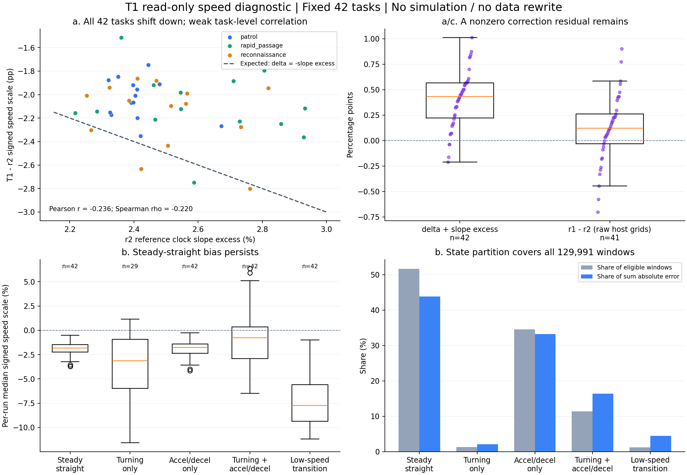

# v0.6.1 时间契约实测验证报告

> **当前授权（2026-10-12，T4 运行前）：** 用户复核确认本机 Windows 加速不可行，取消 T3/T3+，新增 T4（K=4、1 倍速）检验并行能力。下方 T2 停点及其原标准保留；T4 尚未运行，不能据新标准改判 T2。T4 标准、分母和方法见文末预登记，本轮不准备 r3。

> **最新停点：T2 不通过。** 11/42 任务后规则暂停并排空，时钟不可用 6/11；不续跑、不 finalize、不进入 T3/T3+。推荐 r3 采用已通过的 K=2、1 倍速，900 任务约 32.50 小时。本轮不准备 r3，详见文末 T2 证据与资源分析。

## T1：非独占条件，2 路 × 1 倍速

**当前结论：T1 通过（用户与 Claude 最终复核决定）。** 标签、语义、槽位 41/41 一致，几何与时间差异在分母 41 的自然波动基线内；速度整体中位平移 −2.07 个百分点支持时间轴修正。两项残余列为 P2，来源未定位，不再阻塞。此前绝对速度标准及诊断阶段暂缓改判均保留为历史记录；现启用提前记录的后续速度配对标准，用户已授权依次 T2、T3 及条件满足时 T3+。本节记录 T1，后续各组另记；不准备 r3。

本轮依据 `v061_validation_run.md` 及用户后续明确指令执行。用户允许 ChatGPT、Chrome、Edge 等后台程序持续运行，取消原计划的独占检查门槛，将端口起点改为 21100；其他验收标准、禁止补飞和规则暂停不续跑要求均保留。原计划副本、用户覆盖说明及完整证据保存在批次外目录，以下简称 `E`：

`F:/CASIA/Drone Swarm Situational Awareness Algorithm/SwarmData/agent_work/v061_validation/v061_T1_k2_s1_seed2026100812/`

### 执行配置与保护检查

| 项目 | 实测／冻结值 |
| --- | --- |
| 运行代码 | `v0.6.1-time` / `bd1f40a4d8f99d35820a4dc40952d1036549f7fa` |
| 开始前 Git 状态 | HEAD、远端 main、标签提交一致，工作区干净；无其他批次/SITL |
| 批次 ID | `v061_T1_k2_s1_seed2026100812` |
| 任务 / family | 固定 r2 配对任务 42 个 / 14 个；任务顺序、任务身份和输入逐条核对 |
| 协议 / 并行 / 倍率 | v0.6.1 / \(K=2\) / \(1\times\) |
| 数据用途 | `purpose=pilot`，`training_data=false` |
| 端口预检 | 21100–21499 全段 TCP/UDP 独占绑定探测通过，无冲突，无须顺延 |
| T1 实际端口 | shard 0：21100–21199；shard 1：21200–21299 |
| 分片首批错峰 | 30 主机秒；机间任务时序按冻结的 v0.6.1 实现执行 |
| 尝试预算 / 实际尝试 | 84 / 42，无重试、补飞或续跑 |
| 存储预算 | 256 MiB/尝试 + 3 GiB 导出预留，共 24 GiB；开始前 F 盘空闲约 813.75 GiB |
| 用户确认 | SwarmData、ArducopterSITL 已加入卡巴斯基扫描排除；本报告记录用户确认，不替代软件配置审计 |
| plan 文件 SHA256 | `9f43fab6d58371bce36818264f56a141c38892eea387ac7bea2befad402a20ac` |
| r2 bundle 核对 | 导入的 4149/4149 文件逐文件哈希一致；运行后再次核对一致 |
| bundle 哈希映射的 canonical SHA256 | `889a073f4b2a3f93fabf44f1b4389cdef1ba96d5a19e68865dd24621c066e4e2` |
| 结束状态 | `completed=true`、`finalized=true`、`paused=false`、`stopped_reason=null`；未完成尝试 0 |
| 规则记录 | 规则暂停 0、硬停止 0；末 20 次滚动异常 1/20，未达 5 次暂停阈值 |

实际控制器于 **2026-10-12 02:36:24.760–04:07:52.618 UTC** 运行（本地 2026-10-11 19:36–21:07）。使用可见 PowerShell 7 窗口和批次外控制台转录；全程资源每 30 主机秒采样，运行中仅从 `progress.json` 读取进度，读取间隔至少 600 秒。仓库在运行期间保持只读，包括禁止写 pycache；冻结归档、r1/r2/A 与其他旧批次未被重分析或改写。

第一次启动器在控制器启动前因 Python 路径检查错误退出，尝试数为 0。修正仅发生于批次外启动器；真正运行和完成证据位于 `E/launch_02/`。这不是重飞；父目录旧 completion 不作为运行完成证据。

### 完成执行、质量与首次 finalize

质量合格 **41/42**；双通道任务判定成功及语义一致均 **42/42**。唯一不合格为 `a000039 / reconnaissance_0023_v00 / 20261012T040035Z_3b839c91`：阶段任务和 final_hold 已完成，但 `uav_03: receiver failed: SITL closed the TCP connection` 使运行记录为 failed。`run_completed=false`，`execution_constraints_pass=null`（执行约束证据未知，不能写成已确认违反）。其 4 个时钟模型全部 acceptable；无机载参数确认违规、无硬失败。该尝试不属于起飞前重试，没有补飞。

首次 finalize 于 **04:15:05.656–04:18:47.435 UTC** 完成，退出码 0：42/42 episode 加载成功、`audit_issues=[]`；41 条合格且语义一致的数据对应 164 条描述，跳过 1 条不合格数据，描述哈希绑定、完整性、一致性均通过。数据集清单仍标为 pilot、非训练；语言清单通过哈希绑定该数据集。finalize 后的受保护文件和原 plan/bundle 完整性复核通过，之后才写入本报告。

- 数据清单 SHA256：`028cdfc36000b1b966655c362ea6524c88968cea9662f444d77eb1e465e5f04d`
- 语言清单 SHA256：`12d6b98f1eecdc209ccc26219e06eeed9242f171c68b26d3d8e1f7cb48a80dcb`
- 空闲非独占基线：CPU 10%，物理内存占用 46.109%；逐进程记录已追加到 `../idle_baseline.jsonl`，没有覆盖先前被独占门槛阻挡的基线。

### 首次验收指标与本轮配对复核

首次验收按冻结标准判 T1 不通过：速度绝对指标为 1.9002963079%，高于当时的 0.5%。保留原指标、窗口、42 对样本及原冻结方法；最终按用户明确决定改判 T1 通过，认可 41 对自然波动基线与速度整体平移证据。原绝对速度标准未经测量精度验证，属于标准纠错，不是放宽阈值。

#### 固定指标与逐条结论

| 判据 | T1 实测 | 冻结标准 / 基线 | 判定 |
|---|---|---|---|
| 配对完整性 | 42 个任务、42 对 | 42 | 通过 |
| 时钟不可用 | 0/42，126/126 机模型可用 | 0/42 | 通过 |
| 双方合格的标签、语义、槽位 | 分别 41/41、41/41、41/41 | 均 100% | 通过 |
| 真值最小间距绝对差的跨任务中位数 | 0.005359085 m（42/42） | r1/r2 0.003751848 m（41/42）；3 倍 0.011255544 m | 通过（用户认可基线分母 41） |
| 仿真时长绝对差的跨任务中位数 | 0.138849898 s（42/42） | r1/r2 0.134604098 s（41/42）；3 倍 0.403812293 s | 通过（用户认可基线分母 41） |
| 每任务阶段端点绝对差中位数的跨任务中位数 | 0.083633801 s（42/42） | r1/r2 0.069539714 s（41/42）；3 倍 0.208619142 s | 通过（用户认可基线分母 41） |
| 每运行帧数 | 42/42 满足 | 仿真时长 × 10 + 1，边界 ±1 帧 | 通过 |
| 速度尺度绝对误差中位数（保留原测量） | 1.900296308%（42/42） | 原 ≤0.5% 错误标准保留为历史；现看修正方向与量级 | 用户最终复核通过；残余记 P2 |

固定样本 patrol_0012_v00 的 r1 运行 20261009T163156Z_4e342ad8 中，两机时钟模型不可用；其原有真值最小间距本身为 null/unknown，真值 CSV 全部无效。空间值直接读取 quality.truth_separation.minimum_m，未做时间换算，缺失不是由时钟缺失联动丢弃。该任务的时间与阶段窗口因参考源钟不可用而独立缺失。用户本轮复核认可可用 **41/42 对** 足以衡量自然波动：三个基线中位数的实际分母均为 **41**，T1/r2 为 **42**；不补样、不改数据，三个实测中位数均低于相应 3 倍上限，改判通过。原“须 42 对完整才可判通过”的要求仅保留为首次判定历史。

旧 r1/r2 的时长和阶段端点用各运行自己保存的参考时钟模型逆变换到各自的共同源秒；参考规则为自然编号最小的有效且覆盖飞行起点的飞机，无效顺延。真值位置与最小间距保持原有空间值。阶段主统计先在每个任务内对全部匹配的 truth/observation、phase、agent、start/arrival/end 端点绝对差取中位数，再对 42 个任务等权取中位数。

#### 速度尺度公式及有效窗口

固定使用 3D ENU，中心为 \(t\) 的 1 秒窗口及 11 个 10 Hz 点：\(v_p=[p(t+0.5)-p(t-0.5)]/1\)，\(\bar v_F=\sum_{j=0}^{9}(v_j+v_{j+1})(t_{j+1}-t_j)/2\)，\(k=(\bar v_F\cdot v_p)/(v_p\cdot v_p)\)。速度向量直接使用现有导出的 FCU 测量速度；位置差分仅用于验收对照。

首次验收的主指标为每运行 \(100\operatorname{median}(|k-1|)\)，覆盖全部飞机的有效窗口；批次再对 42 个运行等权取中位数。每运行 \(100\operatorname{median}(k-1)\) 原为诊断量，现按用户纠错作为后续组同任务配对标准的基础，不能据此改写旧绝对测量。有效窗口要求 11 行均有效、有限且间隔为 0.1 秒（浮点容差 \(10^{-6}\) 秒），并满足 \(\|v_p\|\ge0.5\) m/s；没有新增意图、阶段、曲率或结果筛选。

| 运行级指标（42/42） | 最小 | 中位数 | p90 | 最大 |
|---|---:|---:|---:|---:|
| T1 绝对主指标 (%) | 0.738787593 | 1.900296308 | 3.383034317 | 4.109588717 |
| T1 带符号诊断 (%) | -4.109588717 | -1.787830507 | -1.000031258 | -0.428548649 |
| r2 绝对对照 (%) | 2.166778694 | 3.395654612 | 3.766450820 | 4.031875598 |
| r2 带符号诊断 (%) | -2.234713217 | 0.297399626 | 1.124583685 | 2.204567591 |

T1 共 140775 个候选窗口、129991 个有效窗口，覆盖 126 个飞机运行；其中 10784 个仅因位置差分速度低于 0.5 m/s 排除；无无效行或断续网格排除。42 个运行的绝对主指标均高于 0.5%。每运行、每机的带符号指标、有效窗口数和排除数保存在完整 report.json；按机展开副本见 paired_report_excerpt.json。

T1 相比 r2 的绝对指标有所下降，但仍未达到固定验收线。带符号中位数和绝对中位数是不同统计量：前者呈现有方向的偏差，后者还包含局部一致性误差。当前统计不足以把偏差归因于时钟比例、位置/速度估计差异或其他具体机制；未试新窗口或更改阈值。

r2 按同一冻结公式得到的绝对指标为 3.3956546%，与此前约 2.5% 的主机／源时钟尺度差属于不同统计口径，不能直接互换。

#### 按意图及飞法

| 分组 | 运行 | 合格 | 任务成功 | 语义一致 | 帧式通过 | 时钟 p95 中位/p90/最大（仿真秒，逐机） | 速度绝对 中位/p90/最大 (%) | 带符号中位 (%) |
|---|---:|---:|---:|---:|---:|---|---|---:|
| 意图: patrol | 14 | 14/14 | 14/14 | 14/14 | 14/14 | 0.032516/0.034911/0.035859 | 3.095922/3.916666/4.109589 | -3.069885 |
| 意图: rapid_passage | 14 | 14/14 | 14/14 | 14/14 | 14/14 | 0.031614/0.035416/0.036653 | 1.681237/1.905723/2.315595 | -1.615885 |
| 意图: reconnaissance | 14 | 13/14 | 14/14 | 14/14 | 14/14 | 0.031566/0.034682/0.035948 | 1.823434/2.284067/2.335804 | -1.722472 |
| 飞法: patrol / staggered_same_loop | 14 | 14/14 | 14/14 | 14/14 | 14/14 | 0.032516/0.034911/0.035859 | 3.095922/3.916666/4.109589 | -3.069885 |
| 飞法: rapid_passage / line_abreast | 14 | 14/14 | 14/14 | 14/14 | 14/14 | 0.031614/0.035416/0.036653 | 1.681237/1.905723/2.315595 | -1.615885 |
| 飞法: reconnaissance / equal_strip_lawnmower | 7 | 7/7 | 7/7 | 7/7 | 7/7 | 0.031057/0.034662/0.035948 | 2.177140/2.315072/2.335804 | -1.974017 |
| 飞法: reconnaissance / equal_strip_rectangular_spiral | 7 | 6/7 | 7/7 | 7/7 | 7/7 | 0.032075/0.034368/0.034987 | 1.626911/1.937073/1.964792 | -1.527636 |

| 分组 | T1/r2 对数 | 双方合格 | 标签/语义/槽位一致 | 间距绝对差中位 (m) | 时长绝对差中位 (s) | 阶段端点主统计中位 (s) |
|---|---:|---:|---|---:|---:|---:|
| 意图: patrol | 14 | 14 | 14/14/14（分母 14） | 0.002603 | 0.192155 | 0.100099 |
| 意图: rapid_passage | 14 | 14 | 14/14/14（分母 14） | 0.007878 | 0.117835 | 0.070484 |
| 意图: reconnaissance | 14 | 13 | 13/13/13（分母 13） | 0.007034 | 0.114924 | 0.089693 |
| 飞法: patrol / staggered_same_loop | 14 | 14 | 14/14/14（分母 14） | 0.002603 | 0.192155 | 0.100099 |
| 飞法: rapid_passage / line_abreast | 14 | 14 | 14/14/14（分母 14） | 0.007878 | 0.117835 | 0.070484 |
| 飞法: reconnaissance / equal_strip_lawnmower | 7 | 7 | 7/7/7（分母 7） | 0.007882 | 0.080774 | 0.091489 |
| 飞法: reconnaissance / equal_strip_rectangular_spiral | 7 | 6 | 6/6/6（分母 6） | 0.004532 | 0.144853 | 0.070638 |

分组统计仅用于诊断，未为各组另设通过门槛，也未据此改变整体判定。

#### 时钟、吞吐与墙钟

126/126 个时钟模型可用；逐机 p95 的中位/p90/最大为 0.032066/0.035059/0.036653 仿真秒；距 0.2 秒线的最小余量 0.163347 秒。参考机 uav_01 为 42/42，顺延运行与被跳过候选均为 0。残差属于被动主机接收残差诊断，不能解释成绝对同步误差上界。每运行最大 p95 的中位/p90/最大为 0.033582/0.035792/0.036653 秒。

分片首批与后续运行的每运行最大残差 p95 中位数分别为 0.032230 秒（n=2）与 0.033855 秒（n=40）。

固定吞吐口径：41 合格 episode / 5459.760 主机秒 × 3600 = 27.034155 合格 episode/小时。分母从最早尝试派发至最后尝试结束，包含失败尝试、错峰与等待；没有相加并行尝试时间。T1 已通过，此值作为后续吞吐比较基准及 K=2、1 倍配置的观测依据。

按冻结方法补充已持久化的控制器起止口径：02:36:24.7598591–04:07:52.6181248 UTC，共 5487.858266 主机秒，41 个合格 episode 对应 **26.895738 episode/小时**。该补充值包含控制器首尾开销，不替代上述主吞吐指标。

| 单次尝试墙钟段（42/42，主机秒） | 中位数 | p90 | 最大 |
|---|---:|---:|---:|
| 尝试总时长 | 232.495 | 349.505 | 423.798 |
| 派发至运行开始 | 19.049 | 20.232 | 21.770 |
| 起飞前准备 | 53.515 | 54.158 | 54.734 |
| 飞行 | 91.254 | 212.240 | 268.300 |
| 飞行后收尾 | 21.965 | 22.277 | 23.118 |
| 运行后分析及 worker 余项 | 33.010 | 68.076 | 147.451 |

上述各段分别取中位数，不应把各中位数相加当作总时长中位数。运行后余项包含分析、校验、台账和 worker 开销，未宣称纯分析 CPU 时间。控制台 save_atomic retry 与 gave-up 次数均为 0。

#### 关键差异及证据

唯一不合格运行 reconnaissance_0023_v00 / a000039 / 20261012T040035Z_3b839c91 为 run_completed=false；其时钟仍可用、双通道任务判定成功且语义一致。根据控制器原始原因复核，其 uav_03 连接关闭属于运行结束完整性失败；不把任务判定成功误报为质量合格。

| 真值间距差最大的任务 | r2 最小间距 (m) | T1 最小间距 (m) | 绝对差 (m) |
|---|---:|---:|---:|
| reconnaissance_0005_v00 | 10.788321 | 10.484453 | 0.303868 |
| rapid_passage_0004_v00 | 10.109809 | 10.023105 | 0.086704 |
| rapid_passage_0010_v00 | 9.507921 | 9.579794 | 0.071873 |
| rapid_passage_0008_v00 | 11.328568 | 11.259024 | 0.069545 |
| reconnaissance_0001_v00 | 8.685958 | 8.646885 | 0.039073 |

最大差为单任务诊断，不替代预定跨任务中位数判据，也不据此更换任务或挑选更有利基线。完整副基线延后，未替代固定 42 对主基线。

分析 PID 53916，2026-10-12T04:20:01.627272+00:00 至 2026-10-12T04:20:37.415368+00:00，在实际控制器完成与 finalize 之后执行。1322 个输入 SHA-256 在分析后复核不变；只读取现有导出，未重分析原始数据、重拟合时钟或写回批次。

- `paired_final_v1\report.json`：`b98ec84d2d9d6dc914529359af705aac6cbe164e297d74203d4ad7765eff9f43`
- `paired_final_v1\input_hashes.json`：`819d814dd240e2904b5d2c96d5a99babab97e542c973908b96df3db793534486`
- `paired_validation.py`：`25ecc70e89478b57c039e043c20468618f20cecaff09c193f3b33b3f97827629`
- `predeclared_method_v1.json`：`8a4a8bd9eeb2010d6b5316d70b8a02a478fd589b86610cfacac6b07c0b1a5b26`
- `launch_02\controller_completion.json`：`3858279da267b2e4b2bff2017f920b1752526b7170a83087d9c2aa6a891a0987`

资源 CPU/内存与逐进程前五由 resources_final_v1 的独立资源统计提供，不与配对诊断混用计时分母。

#### 配对差值分布补充

下表每格为“中位数 / p90 / 最大值”；时间全部为仿真秒。基线始终是原定 42 对，可用样本的分母单列，未使用新的替代样本。

| 分组 / 比较 | 间距有效/预期 | 间距绝对差 (m) | 时长有效/预期 | 时长绝对差 (s) | 窗口有效/预期 | 每任务端点绝对差中位数 (s) |
| --- | ---: | --- | ---: | --- | ---: | --- |
| 全部 / T1–r2 | 42/42 | 0.005359 / 0.037759 / 0.303868 | 42/42 | 0.138850 / 0.389087 / 0.684043 | 42/42 | 0.083634 / 0.235796 / 0.565356 |
| 全部 / r1–r2 基线 | 41/42 | 0.003752 / 0.022743 / 0.097835 | 41/42 | 0.134604 / 0.301675 / 0.721919 | 41/42 | 0.069540 / 0.262941 / 0.370206 |
| 意图: patrol / T1–r2 | 14/14 | 0.002603 / 0.021348 / 0.025940 | 14/14 | 0.192155 / 0.506365 / 0.684043 | 14/14 | 0.100099 / 0.309697 / 0.565356 |
| 意图: patrol / r1–r2 | 13/14 | 0.003447 / 0.020554 / 0.064129 | 13/14 | 0.147753 / 0.451596 / 0.721919 | 13/14 | 0.057202 / 0.250873 / 0.308024 |
| 意图: rapid_passage / T1–r2 | 14/14 | 0.007878 / 0.071174 / 0.086704 | 14/14 | 0.117835 / 0.298389 / 0.341490 | 14/14 | 0.070484 / 0.143449 / 0.184135 |
| 意图: rapid_passage / r1–r2 | 14/14 | 0.005765 / 0.055992 / 0.097835 | 14/14 | 0.135675 / 0.244758 / 0.297906 | 14/14 | 0.070196 / 0.135415 / 0.201260 |
| 意图: reconnaissance / T1–r2 | 14/14 | 0.007034 / 0.032724 / 0.303868 | 14/14 | 0.114924 / 0.456209 / 0.542356 | 14/14 | 0.089693 / 0.279488 / 0.445753 |
| 意图: reconnaissance / r1–r2 | 14/14 | 0.006654 / 0.020985 / 0.036074 | 14/14 | 0.109168 / 0.324277 / 0.439583 | 14/14 | 0.071083 / 0.263026 / 0.370206 |
| 飞法: patrol / staggered_same_loop / T1–r2 | 14/14 | 0.002603 / 0.021348 / 0.025940 | 14/14 | 0.192155 / 0.506365 / 0.684043 | 14/14 | 0.100099 / 0.309697 / 0.565356 |
| 飞法: patrol / staggered_same_loop / r1–r2 | 13/14 | 0.003447 / 0.020554 / 0.064129 | 13/14 | 0.147753 / 0.451596 / 0.721919 | 13/14 | 0.057202 / 0.250873 / 0.308024 |
| 飞法: rapid_passage / line_abreast / T1–r2 | 14/14 | 0.007878 / 0.071174 / 0.086704 | 14/14 | 0.117835 / 0.298389 / 0.341490 | 14/14 | 0.070484 / 0.143449 / 0.184135 |
| 飞法: rapid_passage / line_abreast / r1–r2 | 14/14 | 0.005765 / 0.055992 / 0.097835 | 14/14 | 0.135675 / 0.244758 / 0.297906 | 14/14 | 0.070196 / 0.135415 / 0.201260 |
| 飞法: reconnaissance / equal_strip_lawnmower / T1–r2 | 7/7 | 0.007882 / 0.014341 / 0.017912 | 7/7 | 0.080774 / 0.534657 / 0.542356 | 7/7 | 0.091489 / 0.356309 / 0.445753 |
| 飞法: reconnaissance / equal_strip_lawnmower / r1–r2 | 7/7 | 0.009584 / 0.027350 / 0.036074 | 7/7 | 0.115277 / 0.386171 / 0.439583 | 7/7 | 0.155272 / 0.305920 / 0.370206 |
| 飞法: reconnaissance / equal_strip_rectangular_spiral / T1–r2 | 7/7 | 0.004532 / 0.144991 / 0.303868 | 7/7 | 0.144853 / 0.257679 / 0.285140 | 7/7 | 0.070638 / 0.177850 / 0.239372 |
| 飞法: reconnaissance / equal_strip_rectangular_spiral / r1–r2 | 7/7 | 0.003724 / 0.014616 / 0.019704 | 7/7 | 0.103059 / 0.233273 / 0.262941 | 7/7 | 0.069540 / 0.152322 / 0.262941 |

逐机残差表的分母补充：

| 分组 | 时钟可用运行 | 有效逐机 p95 数 | 最小合格余量 (仿真秒) |
| --- | ---: | ---: | ---: |
| 意图: patrol | 14/14 | 42/42 | 0.164141 |
| 意图: rapid_passage | 14/14 | 42/42 | 0.163347 |
| 意图: reconnaissance | 14/14 | 42/42 | 0.164052 |
| 飞法: patrol / staggered_same_loop | 14/14 | 42/42 | 0.164141 |
| 飞法: rapid_passage / line_abreast | 14/14 | 42/42 | 0.163347 |
| 飞法: reconnaissance / equal_strip_lawnmower | 7/7 | 22/22 | 0.164052 |
| 飞法: reconnaissance / equal_strip_rectangular_spiral | 7/7 | 20/20 | 0.165013 |

### T1 非独占资源观测

本节仅使用实际启动成功的 `launch_02/resources.jsonl`。ChatGPT、Chrome 等后台应用按用户授权保留，结果不代表独占环境。42 次 attempt 全部结束；41 条 run completed，`a000039` 为 failed。时钟不合格为 **0/42**，不能将该失败列为时钟失败。

#### 总体观测（184 次采样）

采样时间为 **2026-10-12 02:36:22.227–04:07:53.482 UTC**，覆盖约 91 分 31 秒。名义间隔 30 主机秒，实际中位 30.009908 秒、最大 30.027107 秒；采样错误 0，184/184 次进程查询成功。每次采集耗时中位 1.169 秒、峰值 2.936 秒，计数器依次查询，并非原子快照。

| 指标 | 中位数 | p95 | 峰值／最低余量 |
| --- | ---: | ---: | ---: |
| 整机 CPU（184 点均为有限 0–100%） | 15.00% | 31.00% | 47.00% |
| 物理内存占用 | 47.763% | 50.825% | 54.791% |
| 可用物理内存 | 33.251 GiB | — | 最少 28.777 GiB |
| Windows 提交额度使用率 | 91.00% | — | 96.00% |
| Windows 已提交内存 | 62.561 GiB | — | 65.992 GiB |

物理内存总量为 63.654 GiB。**提交额度中位 91%、峰值 96%**，与物理驻留占用属于不同口径；不能仅凭物理内存余量宣称不存在内存压力。

#### CPU 计数异常与统计口径

原始 PerfFormattedData 统计完整保留，未 clamp 或改写样本。快照 **172**（**04:01:53.973 UTC**）出现两条不可能的整机归一 CPU 值：

| 名称 | PID | 父 PID | 原始整机归一 CPU |
| --- | ---: | ---: | ---: |
| chrome | 58832 | 7244 | 2016.2812% |
| chrome | 70132 | 7244 | 189.8750% |

异常为 **2/112745 进程行（0.001774%）**、**1/184 快照（0.5435%）**。该快照 Chrome 组原始和为 **2321.3125%**，不是可报告为实际负载的峰值。完整信息见 `resources_final_v1/cpu_counter_anomalies.csv`。

下文 CPU 的有限范围诊断仅使用 0–100% 的进程组快照；组内任一成员异常或组和越界时，整组该快照明确排除，因此 Chrome 为 183 点，其余列出的应用为 184 点。缺席进程在成功快照中计 0；查询失败不补 0。本次没有查询失败。有限范围并不保证计数器绝对准确，不能据此反推故障原因。内存观测未排除。

#### Top 5（同名进程先在每个快照内聚合）

按有限范围 CPU **均值**排序；同时保留原始均值供复核。全部百分比均以整机为分母。

| 进程名 | 原始均值 % | 有限范围均值 % | 中位数 % | 峰值 % | 有效点 |
| --- | ---: | ---: | ---: | ---: | ---: |
| python | 4.6905 | 4.6905 | 4.1406 | 13.2188 | 184 |
| NVDisplay.Container | 3.0701 | 3.0701 | 3.0938 | 3.2188 | 184 |
| arducopter | 2.0822 | 2.0822 | 0.4374 | 11.8126 | 184 |
| chrome | 13.7804 | 1.1709 | 0.1250 | 37.3124 | 183 |
| WmiPrvSE | 1.0151 | 1.0151 | 0.5938 | 4.4062 | 184 |

原始均值排序的 Top 5 为 chrome、python、NVDisplay.Container、arducopter、WmiPrvSE；Chrome 的原始均值受上述异常污染。python 是所有同名进程聚合，不能全部认作仿真、控制器或某一个分析任务。

按**私有工作集峰值**排序（GiB），原始内存样本全部保留：

| 进程名 | 中位数 GiB | 峰值 GiB |
| --- | ---: | ---: |
| python | 0.719 | 4.458 |
| Memory Compression | 1.950 | 4.376 |
| chrome | 2.687 | 4.123 |
| Code | 1.734 | 1.857 |
| ChatGPT | 1.634 | 1.815 |

工作集求和可能重复计算共享页；私有工作集不含共享驻留页。它们不能与整机物理占用逐项直接相加比较。

#### 常驻应用

驻留率是“出现于多少个成功快照／成功快照总数”，不是连续在线时间的精确测量。CPU 为上述有限范围诊断，内存单位 GiB。

| 进程名 | CPU 中位／峰值 % | 私有工作集 中位／峰值 | 工作集 中位／峰值 | 驻留率 |
| --- | ---: | ---: | ---: | ---: |
| ChatGPT | 0.2812／5.4062 | 1.634／1.815 | 2.748／2.925 | 100% |
| chrome | 0.1250／37.3124 | 2.687／4.123 | 4.605／6.318 | 100% |
| msedge | 0.0000／1.7812 | 0.155／0.837 | 0.569／1.764 | 100% |
| msedgewebview2 | 0.2812／3.5937 | 0.404／0.552 | 1.619／1.765 | 100% |
| SogouCloud | 0.0000／1.1875 | 0.062／0.071 | 0.536／0.545 | 100% |
| SGTool | 0.0000／0.0000 | 0.016／0.021 | 0.052／0.057 | 100% |
| sqlservr | 0.0000／3.5938 | 0.087／0.095 | 0.141／0.149 | 100% |

以上实际进程名来自采样。未出现某名称（例如未采到 `avp`）只能说明日志中没有该名称观测，不能声称对应软件不存在、未运行或没有其他服务进程。

#### 观测器、控制器与事后分析自负载

已知控制器/启动器 PID 为 **57712 / 29292**，观测器 PID 为 **60308**。只依据 PID、父 PID 分类，未采集命令行；`controller_descendant` 可能同时含 SITL、worker 和运行内分析 Python。

| 角色 | CPU 中位／均值／峰值 % | 私有工作集 中位／峰值 MiB |
| --- | ---: | ---: |
| controller | 3.1250／3.0239／3.2812 | 66.99／95.79 |
| controller_descendant | 3.0781／3.5754／14.1876 | 172.53／409.84 |
| resource_observer | 0.0000／0.0073／0.6250 | 88.23／105.12 |

主统计脚本本次 PID **69396**，运行于 **2026-10-12T04:15:13.684278+00:00–2026-10-12T04:15:15.491427+00:00**；耗时 1.802 秒、CPU 消耗 1.781 秒、峰值工作集 309.69 MiB。它在 T1 和采样结束后启动，不构成 T1 的负载。后续报告整理同样发生于采样结束后。

#### a000039 的时段对比

任务为 `reconnaissance_0023_v00`，run 为 `20261012T040035Z_3b839c91`。运行 failed／qualified=false；时钟合格，最大每机 p95 残差 **0.0349865 仿真秒**。资源窗口如下：

| 窗口 | UTC 起止 | 点数 | 总 CPU 中位／峰值 % | 物理内存中位／峰值 % | 最少可用 GiB |
| --- | --- | ---: | ---: | ---: | ---: |
| attempt | 2026-10-12T04:00:16.653708+00:00–2026-10-12T04:04:20.203598+00:00 | 8 | 16.50／47.00 | 45.383／46.609 | 33.985 |
| flight | 2026-10-12T04:01:29.621117+00:00–2026-10-12T04:03:09.417963+00:00 | 3 | 37.00／47.00 | 45.516／45.750 | 34.532 |

已记录的运行生命周期结束时间为 **04:03:13.089030 UTC**。邻近观测为：04:02:53.997 CPU 47%、提交额度 93%；04:03:24.014 CPU 13%、提交额度 92%。这些时段数据只能提供背景，不能证明 CPU、提交额度或 Chrome 导致 SITL TCP 关闭。异常 Chrome 快照 172 落在该 flight 窗口内，但其非物理数值尤其不得作为因果证据。

全部 **42 条任务、84 个 attempt/flight 窗口**的简表见 `resources_final_v1/run_resource_summary.csv`；各窗口完整进程分布见 `resource_summary.json` 的 `run_window_resources`。flight 窗口仅有 1–9 个快照，短任务观测稀疏；不得把单点当稳定均值。

#### 局限与证据绑定

30 秒采样看不到间隔内瞬时尖峰。flight UTC 由 metadata.started_utc 与主机 monotonic 偏移换算，属于单墙钟锚点估计。CPU 与内存计数器依次获取，进程树瞬态退出可能留下无法分类的后代。全程非独占；背景资源关联不建立因果，也不代表更高 K 或倍速已经验证。此处没有改动原数据、阈值或原始统计。

下列 SHA256 可绑定本节工具和输入；全部使用 `launch_02` 完成信号：

| 文件 | SHA256 |
| --- | --- |
| Measure-V061Resources.ps1 | `8f94d2862e042c2d5ce6609c505a16be458f8cb2828c8c462cfdb46b9355a4ad` |
| summarize_v061_resources.py | `21eb9494eaf6f0ba5d362f6bf66bc1d8f5866bf47179a0a521a5fa5134e7254a` |
| diagnose_v061_resource_counters.py | `701a4a978123b16bda104d0568f531c9eed61674678ec32c9e06efbb765e8eba` |
| resource_run_windows.json | `9b82c9c4408a01a06da1e330d26384c75181aaf7e7d202bc2f184efdeaee6849` |
| resource_run_windows_sources.json | `6b6fee6729ceb10eabbf38652d974e98a5028c5710b3b90444b434ed32aacb97` |
| launch_02/resources.jsonl | `03fe8a983a9176e51e632fbd89da9b338b0edbcc64d671fc4b79555f492e2a61` |
| launch_02/controller_completion.json | `3858279da267b2e4b2bff2017f920b1752526b7170a83087d9c2aa6a891a0987` |

`resource_run_windows_sources.json` 保留 169 个源文件读取时的哈希。control.json 是 finalize 前的窗口取证快照；随后 authorized finalize 改变 finalized 字段不应误报为资源输入损坏。

## 收尾、复核与 r3 结论

**T1 最终通过，可作为较高配置未通过时的回退推荐：K=2、1 倍速。** 用户现已授权后续各组依次验证，r3 最终配置待各组判定后选择，本轮不 prepare r3。T1 无时钟不合格，不能把速度偏差解释成加速导致，也不能仅凭后台程序存在归因外部干扰。速度偏差和 TCP 关闭的具体机制仍未证实；不修改运行实现、质量标签或已有数据。

按本组墙钟线性外推：900 个任务约 **32.50 小时**，取得 900 个合格 episode 约 **33.29 小时**。前者使用 42 次尝试 / 5459.760 秒，后者使用 41 个合格 / 同一墙钟分母；不含 prepare、finalize、报告或未来重试。固定 42 个任务不覆盖所有生产复杂度，估计不是工期承诺或启动 r3 的授权。本次独立 finalize 另耗约 221.779 主机秒。

本轮未修改运行代码。核验包括：首次 finalize 的数据审计与加载、描述检查、运行前后 4149 文件 bundle 哈希、受保护文件完整性，以及配对分析 1322 个输入哈希复核。外部配对工具 19 项合成检查、终态摘要 5 项检查和资源统计的合成集成检查均通过。独立复核确认失败项、未知项、分母和冻结公式一致；没有用 signed 诊断量或仅合格子集替代速度主指标。

运行代码的远端基线验证为 [CI #45](https://github.com/shy-UCAS/swarm-task-sim/actions/runs/38193847028)。本报告提交后另核对该提交的远端 CI；其精确链接随本轮最终汇报提供，可从 [main 的单元测试工作流](https://github.com/shy-UCAS/swarm-task-sim/actions/workflows/unit-tests.yml?query=branch%3Amain) 查阅。本轮不新增或移动任何标签。

### 证据索引

全部原始证据保留在 `E`，报告中的 `paired_final_v1/`、`resources_final_v1/` 等均相对该目录。主要文件：

- `execution_context.json`、`preparation_checks.json`、`post_finalize_integrity.json`：用户覆盖条件、准备和运行后完整性证据。
- `v061_validation_run.md`、`predeclared_method_v1.json`：原计划及运行前固定的统计方法；后者 SHA256 已列于配对节。
- `baseline_primary42_v1/`：启动前的 42 对历史基线和 899 个输入哈希；历史分析结束早于 T1 启动。
- `launch_02/controller_started.json`、`launch_02/controller_completion.json`、`launch_02/progress_snapshots.jsonl`、`launch_02/console_*.log`、`launch_02/resources.jsonl`：真实启动、退出、进度读取、控制台及完整资源采样。
- `T1_run_summary.json`：终态细节，SHA256 `bf495ad49afa9d7dedefb5099ae843f767200adc9f89dbec3a6b711272fa1d23`；记录的是首次 finalize 前的 control 哈希，不与随后合法收尾混淆。
- `finalize_receipt.json`、`finalize_console.log`：一次性收尾操作及其退出码。
- `paired_final_v1/report.json`、`paired_final_v1/input_hashes.json`、`paired_report_excerpt.json`：全量运行/逐机/分组指标及证据绑定。
- `resources_final_v1/resource_summary.json`、`resources_final_v1/run_resource_summary.csv`、`resources_final_v1/process_name_timeline.csv`、`resources_final_v1/process_pid_timeline.csv`、`resources_final_v1/cpu_counter_anomalies.csv`：全部时段资源与异常诊断。

只读工具保留在 `E`，使用项目 Conda `llm`、Python `-B` 和 `PYTHONDONTWRITEBYTECODE=1` 执行；重读工具不得覆盖已有输出。整个验证不改写旧批次。

## 用户复核与只读速度诊断（2026-10-11）

### 本轮决定与范围

用户明确认可三项空间/时间比较使用 41 个有效 r1–r2 配对作为自然波动基线；因此上表三项改判通过，基线实际分母写为 41，T1/r2 分母为 42。原缺失任务仍保留，不换样、不补飞。首次冻结方法文件和报告提交 a1ebf49 保留原判定，不伪装成原来就使用本轮规则。

用户指出原绝对速度标准是在未验证测量精度前设定，要求纠正该标准，**不是看结果后提高阈值来放宽验收**。本轮先检查时间尺度修正的配对证据；不自动把新的带符号指标达成某个数值视为通过，不新增用户未给出的相关系数门槛。

**历史诊断结论（最终判定已由文末用户决定取代）：** a 的方向与量级得到支持，但逐任务关系尚不足以确认；b 不支持残余主要来自机动滞后的解释。诊断阶段曾暂缓改判并等待用户复核。以下数值和因果限制保留，最终 T1 通过并不意味着残余机制已被解释。

新证据目录为 E/speed_review_20261011_v1/，下文称 R。method.json 在计算前保存；状态划分、散点分组和自举规则计算后均未调整。

### a：逐任务带符号变化与 r2 时钟斜率

沿用初次诊断的 1 秒、11 点、3D ENU 及原有效窗口规则。设每运行指标为 \(S=100\operatorname{median}(k-1)\)，数值以百分数表示；逐任务 \(\Delta=S_{T1}-S_{r2}\) 的单位为**百分点**，不是两批中位数直接相减。参考机取原报告的确定性规则：自然编号最小、模型有效且覆盖飞行纪元的飞机；r2 42/42 均为 uav_01。

主对照为参考机全局拟合斜率 \(a_r\)（主机秒/源秒），\(X=100(a_r-1)\)，预期近似 \(\Delta\approx-X\)。每个任务等权；符号取向固定为 T1 减 r2。原斜率只读使用，不重拟合。全局斜率并非每个飞行窗口的局部时钟比例，另给有效窗口与各机中位斜率的辅助结果，不替换主对照。

| 量 | n | 最小 | p5 | p25 | 中位数 | p75 | p95 | 最大 |
| --- | ---: | ---: | ---: | ---: | ---: | ---: | ---: | ---: |
| \(\Delta\)（百分点） | 42 | -2.800820 | -2.623206 | -2.225156 | -2.073160 | -1.925500 | -1.798023 | -1.515000 |
| \(X\)（%） | 42 | 2.217386 | 2.267185 | 2.386603 | 2.453342 | 2.582137 | 2.856333 | 2.932816 |
| \(\Delta+X\)（百分点） | 42 | -0.210394 | -0.038658 | 0.219878 | 0.432617 | 0.565298 | 0.843944 | 1.010855 |

- 42/42 的变化方向与去掉主机尺度差一致，典型变化约为 −2.07 个百分点，对应的原时钟偏离量约为 +2.45%。
- Pearson \(\operatorname{corr}(\Delta,X)=-0.236430\)，Spearman \(\rho=-0.220485\)。若改画 \(-X\)，两者符号相反。描述性 OLS 为 \(\Delta=-0.317902X-1.306354\)，没有得到斜率 −1、截距 0 的贴合关系；没有据此设置新的通过阈值。
- 考虑同 family 内三个任务相关，以 14 个完整 family 为单位、固定种子 20261011 做 5000 次自举：Pearson 95% 区间 **[-0.487703, 0.064834]**；Spearman **[-0.499966, 0.111926]**；\(\Delta\) 中位数 **[-2.155171, -2.009134]** 个百分点；\(\Delta+X\) 中位数 **[0.334813, 0.501892]** 个百分点。区间是描述性不确定性，不是追设的门禁。
- 不能用“都是负数”代替逐任务对应；也不能因斜率取值范围较窄、相关性较弱，就反向断言时间修正无效。当前结果支持主要方向，但尚留系统残差，不足以完成用户要求的确认。

散点按 \(X\) 从小到大分成四组（任务 ID 作相同值的次序键；11、11、10、10 个），给出条件分位数：

| 斜率排序组 | n | \(X\) 范围（%） | \(X\) 中位（%） | \(\Delta\) p5（百分点） | \(\Delta\) 中位（百分点） | \(\Delta\) p95（百分点） | \(\Delta+X\) 中位（百分点） |
| --- | ---: | --- | ---: | ---: | ---: | ---: | ---: |
| Q1 | 11 | 2.217386–2.385096 | 2.323298 | -2.237673 | -2.050283 | -1.681290 | 0.243756 |
| Q2 | 11 | 2.391122–2.461581 | 2.411079 | -2.492500 | -2.010274 | -1.805761 | 0.393579 |
| Q3 | 10 | 2.465976–2.587490 | 2.530752 | -2.608160 | -2.087199 | -1.896517 | 0.453365 |
| Q4 | 10 | 2.672403–2.932816 | 2.784156 | -2.603955 | -2.239339 | -1.835843 | 0.587328 |

辅助口径，均 n=42：

| 斜率口径 | 偏离量中位（%） | Pearson | Spearman | \(\Delta+X\) 中位（百分点） |
| --- | ---: | ---: | ---: | ---: |
| 原参考机全局斜率（主） | 2.453342 | -0.236430 | -0.220485 | 0.432617 |
| 每运行全部有效机模型斜率的中位数 | 2.443562 | -0.339627 | -0.289847 | 0.422023 |
| 参考模型飞行窗有效斜率 \(D_{host}/D_{source}\) | 2.385264 | -0.349463 | -0.178187 | 0.319692 |

线性近似之外，辅助计算乘法预测残差 \(S_{T1}-100[(1+S_{r2}/100)/a_r-1]\)：中位 **0.368603**、p5 **−0.078924**、p95 **0.783840** 个百分点。仍有偏移，不能把近似式与精确乘除的差别单独当作全部解释；且该辅助式仍使用全局斜率，不是重采样后的反事实运行。

### b：按位置差分划分运动状态

仅分解 T1 原有 **129991/140775** 个有效窗口；其余 10784 个仍因整窗位置差分速率低于 0.5 m/s 排除。每个 1 秒窗口的前后半段分别计算 \(v_-=[p(t)-p(t-0.5)]/0.5\)、\(v_+=[p(t+0.5)-p(t)]/0.5\)。两向量均取 3D ENU：

- 方向夹角 \(>5^\circ\)：转弯；速率变化率 \(\alpha=(\|v_+\|-\|v_-\|)/0.5\) 满足 \(|\alpha|>0.2\,\mathrm{m/s^2}\)：加减速。
- 两者同时满足单列“混合”；仅满足一个分别列为“纯转弯”“纯加减速”；均不满足列为“匀速直线”（操作性近似，不宣称严格恒速）。
- 任一半窗速率 \(<0.5\,\mathrm{m/s}\) 时，方向分类不稳定，单列“低速过渡”。临界值等于阈值归入较低状态。
- 全部有效窗口恰好属于一类。划分只读取位置与时间，未使用 FCU 速度偏差、任务成功或已知判定来选类；不新增质量筛选，不改变原总体指标。

下表的“带符号中位”先在每运行该状态内取中位，再对有该状态的运行等权取中位；缺失状态不填 0。窗口占比与绝对误差总量贡献是额外的窗口汇总描述，不能替代运行等权主统计。

| 状态 | 有效窗口 | 运行分母 | 窗口占比 | 带符号中位（%） | 带符号 p5 / p95（%） | 绝对误差中位（%） | 绝对误差总量贡献 |
| --- | ---: | ---: | ---: | ---: | --- | ---: | ---: |
| 匀速直线 | 67162 | 42/42 | 51.667% | -1.816471 | -3.529752 / -0.773702 | 1.818739 | 43.816% |
| 纯转弯 | 1613 | 29/42 | 1.241% | -3.138508 | -10.341830 / 0.574855 | 3.331916 | 2.102% |
| 纯加减速 | 44865 | 42/42 | 34.514% | -1.757394 | -3.583954 / -0.840038 | 1.938076 | 33.255% |
| 转弯与加减速混合 | 14767 | 42/42 | 11.360% | -0.757086 | -5.395168 / 5.036368 | 2.639397 | 16.380% |
| 低速过渡 | 1584 | 42/42 | 1.219% | -7.739381 | -10.494773 / -1.292185 | 9.738125 | 4.448% |

纯加减速窗口再按方向拆分：加速 25276 个（42/42 运行），带符号中位 **−1.218755%**；减速 19589 个（42/42），**−2.485841%**。混合状态的加速为 8081 个（42/42），**+0.136776%**；减速为 6686 个（29/42），**−4.420342%**。

纯转弯与低速过渡的误差较大，但匀速直线覆盖超过一半窗口，偏差 **−1.816%** 与总体带符号中位 **−1.788%** 接近，且纯加减速的两个方向都为负。因而本次分解**不支持把总体残余主要解释为转弯/加减速造成的速度滞后**。这是对该解释的证据限制，不是证明另一种机制；未做移位拟合或重采样，也未将关联当成因果，不能排除位置/速度估计、采样或时间尺度等因素的共同影响。

### c：r1 与 r2 的带符号自然波动

固定定义 \(N=S_{r1}-S_{r2}\)，两边均直接在旧主机时间网格使用同一速度公式。有效 **41/42**，patrol_0012_v00 / 20261009T163156Z_4e342ad8 的 r1 原导出没有有效速度窗口，保持缺失，不用别的任务替换。

| 量（百分点） | n | 最小 | p5 | p25 | 中位数 | p75 | p95 | 最大 |
| --- | ---: | ---: | ---: | ---: | ---: | ---: | ---: | ---: |
| \(N=S_{r1}-S_{r2}\) | 41 | -0.702076 | -0.446559 | -0.031164 | 0.121705 | 0.260967 | 0.583911 | 0.900699 |
| \(\lvert N\rvert\) | 41 | 0.003307 | 0.033116 | 0.103524 | 0.223802 | 0.418352 | 0.702076 | 0.900699 |

| 意图 | n | \(N\) 中位（百分点） | \(N\) p5 / p95（百分点） |
| --- | ---: | ---: | --- |
| patrol | 13/14 | 0.068797 | -0.087307 / 0.323921 |
| rapid_passage | 14/14 | 0.328667 | -0.416677 / 0.817183 |
| reconnaissance | 14/14 | 0.109066 | -0.535990 / 0.331999 |

自然波动含旧运行之间的时钟比例、测量与采样差异，不是测量误差真值。\(\Delta+X\) 的中位残差 0.432617 个百分点约为 \(|N|\) 中位 0.223802 的 1.93 倍；这只是量级对照，**未把 1.93 倍或其他新数值变成门槛**。虽然 T1/r2 的主要偏移明显大于 r1/r2 典型波动，剩余系统差仍需解释，不能凭主要方向相符就宣告 a 完全成立。

### 逐任务数值

\(S\) 各列单位为 %；\(\Delta\)、残差和 \(N\) 为百分点。行与固定选择清单一致，r1 缺失只影响相应列。

| 任务 | \(S_{r1}\) | \(S_{r2}\) | \(S_{T1}\) | \(\Delta\) | \(X\) | \(\Delta+X\) | \(N\) |
| --- | ---: | ---: | ---: | ---: | ---: | ---: | ---: |
| patrol_0000_v00 | -0.940102 | -1.201069 | -3.121564 | -1.920496 | 2.396769 | 0.476273 | 0.260967 |
| rapid_passage_0000_v00 | 0.332970 | 0.622032 | -1.591590 | -2.213622 | 2.465976 | 0.252354 | -0.289062 |
| reconnaissance_0000_v00 | 0.541450 | 0.403278 | -1.461800 | -1.865078 | 2.411223 | 0.546145 | 0.138172 |
| patrol_0001_v00 | -0.108324 | -0.230030 | -2.429190 | -2.199161 | 2.411079 | 0.211919 | 0.121705 |
| rapid_passage_0001_v00 | 1.279431 | 1.858022 | -0.891886 | -2.749908 | 2.587490 | -0.162418 | -0.578591 |
| reconnaissance_0001_v00 | 1.939852 | 2.204568 | -0.428549 | -2.633116 | 2.422723 | -0.210394 | -0.264715 |
| patrol_0002_v00 | -1.670020 | -1.703136 | -3.660622 | -1.957486 | 2.410316 | 0.452830 | 0.033116 |
| rapid_passage_0002_v00 | 1.210269 | 0.656152 | -1.467840 | -2.123992 | 2.546296 | 0.422304 | 0.554117 |
| reconnaissance_0002_v00 | 0.417535 | 0.302927 | -1.974017 | -2.276944 | 2.733996 | 0.457052 | 0.114607 |
| patrol_0003_v00 | -1.816361 | -2.234713 | -3.981157 | -1.746444 | 2.445102 | 0.698658 | 0.418352 |
| rapid_passage_0003_v00 | 0.269892 | 0.599386 | -1.629615 | -2.229000 | 2.729601 | 0.500601 | -0.329493 |
| reconnaissance_0003_v00 | 0.803485 | 1.250044 | -1.550776 | -2.800820 | 2.762043 | -0.038777 | -0.446559 |
| patrol_0004_v00 | -0.699826 | -0.749248 | -3.018207 | -2.268959 | 2.672403 | 0.403444 | 0.049422 |
| rapid_passage_0004_v00 | 0.848232 | -0.052466 | -1.847881 | -1.795415 | 2.806270 | 1.010855 | 0.900699 |
| reconnaissance_0004_v00 | 0.543022 | 0.148169 | -1.902114 | -2.050283 | 2.385096 | 0.334813 | 0.394853 |
| patrol_0005_v00 | -1.480036 | -1.548832 | -3.396412 | -1.847580 | 2.350762 | 0.503183 | 0.068797 |
| rapid_passage_0005_v00 | 0.775364 | 0.548745 | -1.814597 | -2.363341 | 2.929363 | 0.566021 | 0.226619 |
| reconnaissance_0005_v00 | 0.079559 | -0.023965 | -1.907467 | -1.883502 | 2.469991 | 0.586489 | 0.103524 |
| patrol_0006_v00 | 1.050388 | 0.891017 | -1.119256 | -2.010274 | 2.403852 | 0.393579 | 0.159371 |
| rapid_passage_0006_v00 | 1.437742 | 1.350532 | -0.807041 | -2.157573 | 2.217386 | 0.059813 | 0.087210 |
| reconnaissance_0006_v00 | 1.444066 | 1.145912 | -0.794603 | -1.940515 | 2.323298 | 0.382783 | 0.298154 |
| patrol_0007_v00 | -1.047502 | -1.247111 | -3.159535 | -1.912424 | 2.479540 | 0.567116 | 0.199610 |
| rapid_passage_0007_v00 | 0.534197 | -0.238016 | -1.753017 | -1.515000 | 2.359962 | 0.844962 | 0.772213 |
| reconnaissance_0007_v00 | 0.122619 | -0.103763 | -2.112897 | -2.009134 | 2.252890 | 0.243756 | 0.226382 |
| patrol_0008_v00 | -1.501236 | -1.329714 | -3.398818 | -2.069104 | 2.391122 | 0.322019 | -0.171522 |
| rapid_passage_0008_v00 | 0.308900 | 0.488613 | -1.761064 | -2.249677 | 2.858312 | 0.608635 | -0.179713 |
| reconnaissance_0008_v00 | -0.264109 | -0.260801 | -2.205627 | -1.944826 | 2.818723 | 0.873897 | -0.003307 |
| patrol_0010_v00 | 0.828379 | 0.604577 | -1.273136 | -1.877712 | 2.320642 | 0.442930 | 0.223802 |
| rapid_passage_0010_v00 | 1.326641 | 0.742730 | -1.374757 | -2.117487 | 2.932816 | 0.815329 | 0.583911 |
| reconnaissance_0010_v00 | 0.205202 | 0.907278 | -1.527636 | -2.434914 | 2.505951 | 0.071038 | -0.702076 |
| patrol_0012_v00 | 缺失 | -1.936893 | -4.109589 | -2.172695 | 2.329777 | 0.157082 | 缺失 |
| rapid_passage_0012_v00 | 0.476452 | 0.291872 | -1.690731 | -1.982603 | 2.545730 | 0.563127 | 0.184580 |
| reconnaissance_0012_v00 | 0.680041 | 0.769638 | -1.533014 | -2.302651 | 2.266268 | -0.036384 | -0.089596 |
| patrol_0014_v00 | 0.481358 | 0.445230 | -1.707539 | -2.152769 | 2.325120 | 0.172350 | 0.036127 |
| rapid_passage_0014_v00 | 1.407534 | 0.932624 | -0.986784 | -1.919408 | 2.461581 | 0.542173 | 0.474910 |
| reconnaissance_0014_v00 | 1.102427 | 0.863456 | -1.213760 | -2.077216 | 2.561641 | 0.484425 | 0.238971 |
| patrol_0021_v00 | 0.463566 | 0.494730 | -1.857154 | -2.351884 | 2.420684 | 0.068800 | -0.031164 |
| rapid_passage_0021_v00 | 0.308418 | -0.122560 | -2.265632 | -2.143073 | 2.284611 | 0.141538 | 0.430978 |
| reconnaissance_0021_v00 | 0.097521 | -0.076702 | -2.067085 | -1.990383 | 2.566080 | 0.575697 | 0.174222 |
| patrol_0023_v00 | -0.624526 | -0.682659 | -2.749719 | -2.067060 | 2.398640 | 0.331580 | 0.058133 |
| rapid_passage_0023_v00 | 0.713816 | 0.283101 | -1.602154 | -1.885255 | 2.709859 | 0.824604 | 0.430715 |
| reconnaissance_0023_v00 | 0.140424 | 0.203013 | -1.894168 | -2.097181 | 2.515774 | 0.418592 | -0.062589 |

### 后续标准、审计与停点

用户给出的 T2/T3（含 T3+）速度配对标准已在 [时间契约计划](v06_time_contract_plan.md) 中提前记录，现随 T1 最终通过启用：固定相同任务，先计算带符号速度尺度差，再取其绝对值的跨任务中位数，不超过 **0.5 个百分点**。它检验加速前后是否保持数据含义；原标准未经测量精度验证，此次为标准纠错，不是看结果后放宽；不改旧测量、质量标签或控制器。

诊断阶段仅落实三项配对比较改判并暂停等待用户；该历史停点现由下方最终决定取代。所有诊断证据保持原样。

原报告中的 126 条运行带符号指标（含原缺失）逐一复算一致；T1 分类后合并的指标与原值一致。外部诊断合成自检通过；读取的 **388/388** 个输入文件前后哈希一致。结果仅写入新外部目录，写保护审计拒绝其他位置写入及任何子进程/仿真调用。仓库改动仅为报告、计划和图表，不修改运行代码或旧数据。证据：

| 文件（相对 R） | SHA256 |
| --- | --- |
| method.json | ee3a29e7a093d5a046e900846212a6732db55fce042d19b70852a8e1aa639731 |
| review_speed.py | c3e1f37d5d786fb0e46793a4ec7c5ad7fe3de77214ba6798a9d55bdbde14cae5 |
| results/report.json | 67b0aa64356613db6ec04fff9d32470db9cd4d6c8b118ab121ed9890e362badb |
| results/input_hashes.json | 5a3c3ff346c50e96121706950e5b7101c6ac65fe3e09a2dc06ee68dab8698501 |
| results/task_pairs.csv | 16b323396c09aecb70280a4c22bee4995a0dd4d9e9ca1e25fb4be943e49e4d65 |
| results/t1_motion_windows.csv | a06a98d50e68c0642c6a172723870012b5c2b9d05ce8350bef7c37614a738ab7 |
| figures/t1_speed_review.png | 53b9df5c1a801ab3fdcad583c3744d0eac617e3f8a5b6a09ae5593e6c54080ee |

完整任务对、每窗口状态、各状态每运行中位数、辅助斜率对照与区间均保存在 R；图表是同一结果的静态展示，未另算不同口径。

## 最终复核决定与后续启动前基线（2026-10-11）

用户与 Claude 按原则二“它会让哪项研究结果出错”共同决定 **T1 通过**。三项类别 41/41 一致，几何和时间在分母 41 的自然波动范围内；整体中位平移 −2.073160 个百分点，相比预期约 −2.385264 至 −2.453342，支持时间轴修正。逐任务斜率变化范围窄、与自然波动相当，弱相关不作为否定依据。此决定覆盖此前暂缓改判，不覆盖或删除测量证据。

以下两项记 **P2 已知特性**，同步写入数据契约，不再阻塞：

1. FCU 报告速度与位置差分约 −1.8% 至 −2.1% 的固有尺度差，在匀速直线段同样存在，来源未定位。用户复核结论为所有版本（含 v0.5）都有且不影响任何标签和判定；本轮新增直接测量限于 T1/r1/r2，未对 v0.5 补做速度诊断。
2. 时间轴修正实现预期平移的约 85%，剩余约 0.3–0.4 个百分点未解释。P2 是已知特性分级，不是因果已解释。P3 已登记：后续检查 SIM 真值通道同类尺度差，以区分飞控估计与坐标换算，本轮不实施。

后续速度标准采用固定 42 任务的 \(\operatorname{median}_m|S_{Tj,m}-S_{T1,m}|\le0.5\) **个百分点**，缺失不按通过处理。残差统计继续以 126 个“运行×飞机”模型等权，T1 中位 0.032066338 仿真秒；T2/T3 中位上限约 0.048099507 秒、最大值 ≤0.2 秒。帧数、仿真时长和最小间距的绝对差中位上限分别为 3 帧、0.403812293 仿真秒、0.011255544 m（自然基线 41 对）；阶段窗口继续列诊断，不新增后续组门槛。吞吐相对 T1 的 1.6/3/4.5 倍要求分别为 43.254648、81.102465、121.653698 合格 episode/小时。原验收范围不因非独占而放宽。

用户已调大页面文件并重启。新空闲基线于 **2026-10-12 05:59:18.099 UTC**（本地 10-11 22:59）记录：提交额度上限 **109687336960 字节 / 102.154293 GiB**，已提交 **31958491136 字节 / 29.763664 GiB**，Windows 提交使用率计数器 **29%**（整数计数）；CPU 15%，物理内存占用 39.758%，采到 466 个进程，无采样错误。此前 T1 的提交内存峰值 96% 与此新基线属于不同页面文件配置，不混为同一额度。基线中的主要应用组包括 ChatGPT（工作集 3.425 GiB / CPU 0.469%）、Chrome（2.423 GiB / 4.594%）、Edge（0.667 GiB / 0%）、WebView2（1.517 GiB / 0%）、SQL Server（0.712 GiB / 0%）；DeepSeek Harness 单个高负载进程工作集 0.688 GiB、CPU 3.938%。这些是瞬时值，运行期间另报完整统计。

基线原始证据为 `../v061_T2_k2_s2_seed2026100812/idle_after_reboot.jsonl`，SHA256 `bc16b4da02218129dc8bd7f36814b67cda84881742550ad35a3b5c9b0bc9032d`；摘要为同目录 `idle_baseline_summary.json`，原始快照也追加至公共 `../idle_baseline.jsonl`。用户已授权顺序执行 T2 → T3 →（T3 通过且最大残差 <0.1 仿真秒时）T3+；每组结束立即判定，不通过、规则暂停或停止均不续跑并停止后续组。本轮只给 r3 推荐配置与时长，不 prepare r3。

## T2：非独占条件，2 路 × 2 倍速，规则暂停后不通过

**T2 不通过；不续跑，不进入 T3/T3+。** 本组仅执行 11/42 个任务（无重试），剩余 31 个未执行。时钟不可用 6/11，质量合格 5/11；在第 10 次登记时触发 5 次滚动异常规则，停止派发，最后一条在飞任务自然排空后异常为 6/11。没有 finalize、合并数据集或生成描述，没有补飞或改动门禁。T1 通过结论保持；r3 推荐退回已通过的 K=2、1 倍速，本轮不准备 r3。

本节以启动前冻结方法和用户最终决定验收，证据根目录记为 E2：
F:/CASIA/Drone Swarm Situational Awareness Algorithm/SwarmData/agent_work/v061_validation/v061_T2_k2_s2_seed2026100812/。
公共工具/方法目录 H 为同级 followup_20261011_v1/。全部诊断只读保存的分析产物与资源采样，不重新拟合时钟或重分析原始飞行日志。

### 配置、执行和停点

| 项目 | 值 |
| --- | --- |
| 批次 | v061_T2_k2_s2_seed2026100812 |
| 任务 | 固定 r2 42 任务 / 14 family；实际执行 11 任务 / 4 family / 29 架次 |
| 协议与用途 | v0.6.1，K=2，sim_speedup=2；pilot，training_data=false |
| 运行代码 | v0.6.1-time / bd1f40a4d8f99d35820a4dc40952d1036549f7fa；之后仅文档变更 |
| 启动提交 | 4d6211fb690eee547527cda368961039ebc00605；与远端一致、工作区干净 |
| 启动前 CI | [38211192737](https://github.com/shy-UCAS/swarm-task-sim/actions/runs/38211192737)，367 项测试通过，185.263 秒 |
| 端口 | 21100–21499 全段两次 TCP/UDP 独占绑定预检，800/800 成功；实际两片 21100–21199、21200–21299 |
| 错峰 / 预算 | 分片首批 30 主机秒；最多 84 次尝试；256 MiB/次 + 3 GiB 预留，共 24 GiB |
| 实际控制器 | 2026-10-12 06:18:46.149–06:37:10.976 UTC（本地 10-11 23:18–23:37） |
| 暂停触发 | 06:35:32.532 UTC，a000009，第 10 次登记，5/10 异常（窗口上限 20） |
| 排空 | a000010 在暂停后完成；06:37:10.915 UTC 排空；未完成尝试 0 |
| 最终状态 | paused=true，pause_kind=rule，completed=false，finalized=false，stopped_reason=null |
| 台账写入 | 转录中 save_atomic 重试 0、重试用尽 0；规则暂停 1，硬停止 0 |
| 输入核对 | 运行前后 4149/4149 个 bundle 文件与 r2 逐文件哈希一致；受保护文件核对通过 |

计划 SHA256：66d88abccd9b6d593e6596f2fb1c3e689af03300b5201c4878a51a02a27731ad。
bundle 哈希映射 canonical SHA256：889a073f4b2a3f93fabf44f1b4389cdef1ba96d5a19e68865dd24621c066e4e2。
方法 SHA256：3b7ebc3b043b19c94f38dafa1ad85cfe4cb5e3427d21869a2ce7e1e20ff2e0e3。

### 逐项标准与分母

| 项目 | 实测与分母 | 既定标准 | 判定 |
| --- | --- | --- | --- |
| 执行完整性 | 11/42 已执行，31 未执行；规则暂停 | 全部 42、无暂停/停止 | 不通过 |
| 时钟不可用 | 已执行中 6/11；模型 17/29 不可用，12/29 可用；未执行另有 97 个模型无观测 | 0/42 运行不可用 | 不通过，已有反例 |
| 模型残差 p95 中位 | 可用 12/29：0.117035540 仿真秒；另 17 未知 | 126 个模型，中位 ≤0.048099507 秒（T1 的 1.5 倍） | 已观测子集超限；全组缺失，不能通过 |
| 模型残差 p95 最大 | 可用 12/29 最大 0.138001008 秒 | 最大 ≤0.2 仿真秒 | 观测子集未超限，17 未知，不能判全组通过 |
| 双方合格的标签 / 语义 / 槽位 | 分别 5/5、5/5、5/5 一致 | 双方合格 100% | 已执行可比部分通过；不外推未执行任务 |
| 最小间距差绝对值中位 | 5/11 可计算：0.004257206 m；6 未知 | 固定 42 配对，≤0.011255544 m（自然基线 41 对的 3 倍） | 不完整，未知 |
| 仿真时长差绝对值中位 | 5/11 有效时间轴：0.189081998 s；6 未知 | 固定 42 配对，≤0.403812293 s | 不完整，未知 |
| 帧数差绝对值中位 | 5/11 有效轨迹：2 帧；6 空产物 | 固定 42 配对，≤3 帧 | 不完整，未知 |
| 每运行 10 Hz 帧数关系 | 5/11 有效运行满足；6 无时间轴、无有效轨迹 | 全部满足 \(T=10D+1\)，边界 ±1 帧 | 不能通过 |
| 带符号速度尺度配对差的绝对值中位 | 5/11 可计算：0.056894074 个百分点；6 无有效窗口 | 固定 42 配对，≤0.5 个百分点 | 不完整，未知；不能筛 5 条后改判通过 |
| 合格运行吞吐 | 5 / 1085.451408 主机秒 ×3600 = 16.582963/小时 | ≥43.254648/小时（T1 的 1.6 倍） | 实测低于要求，批次亦未完成 |
| 确认违规 / 小于 2 m | worker 确认硬违规 0；5 条可计算最小间距均 ≥8.973905 m，6 条未知 | 确认违规即停；一组 ≥2 次小于 2 m 则停 | 无已确认触发，不把未知解释为安全证明 |

残差可用子集中位 / p90 / 最大为 **0.117036 / 0.127829 / 0.138001 仿真秒**；相对 0.2 秒的余量中位 / 最小为 **0.082964 / 0.061999 秒**。相同 5 个任务的 T1 共 12 个模型中位为 0.032454 秒，残差升高并非只由换任务构成解释；这一配对诊断不替换原全组门槛。有效参考机均为 uav_01（5/11），成功顺延 0；其余 6/11 的全部 17 个候选模型被拒绝，无可用参考机。任务成功和语义一致均为 5/11，另外 6/11 为未知；不能把飞行进程正常结束（11/11 completed）当作标签成功。

冻结工具输出保留原样，并另存部分批次的解释表：工具的 clock_unavailable.actual=37 是 \(42-5=6+31\)，不能写成 37 次实测失败；6 个不可用时间轴的 duration=0、frames=0 是空产物，不是零秒飞行。原帧数公式在 ±1 容差下对这些空值机械成立，因此不能把工具的 11/11 写成有效轨迹验收通过。这里将未知保留为未知，未改变数据、公式或阈值；可用 5 条的分布仅作诊断。

可计算的配对分布如下，各行均只有 5/11 有效，另 6 个已执行任务未知、31 个未执行；阶段窗口为诊断项。

| 量 | 中位数 | p90 | 最大 |
| --- | --- | --- | --- |
| 最小间距绝对差（m） | 0.004257 | 0.012657 | 0.017920 |
| 仿真时长绝对差（s） | 0.189082 | 0.439234 | 0.604055 |
| 帧数绝对差（帧） | 2.000000 | 4.400000 | 6.000000 |
| 逐任务阶段端点绝对差中位（s） | 0.081792 | 0.320000 | 0.400000 |
| 带符号速度差绝对值（百分点） | 0.056894 | 0.093660 | 0.114021 |

有效 5 条的原绝对速度误差中位为 1.768727%，带符号中位为 −1.705611%，共 14540 个有效窗口；它们是测量诊断，绝对误差 0.5% 的旧错误标准没有重新启用。

按意图和飞法分组（本组尚未覆盖其他飞法）：

| 意图 | 飞法 | 已执行 | 质量 / 成功 / 语义一致（各自） | 时钟不可用运行 | 可用模型 | 残差中位 / p90 / 最大（s） |
| --- | --- | --- | --- | --- | --- | --- |
| patrol | staggered_same_loop | 4 | 2/4 | 2/4 | 6/11 | 0.123747/0.133063/0.138001 |
| rapid_passage | line_abreast | 4 | 2/4 | 2/4 | 4/11 | 0.101431/0.113077/0.114276 |
| reconnaissance | equal_strip_rectangular_spiral | 3 | 1/3 | 2/3 | 2/7 | 0.119711/0.121594/0.122065 |

上述分组的间距差 / 时长差 / 帧数差 / 速度配对差中位如下；完整 p90、最大及分片分组见 E2/partial_interpretation_v1/facts.json。

| 意图 | 有效配对 | 间距 m | 时长 s | 帧数 | 速度百分点 |
| --- | --- | --- | --- | --- | --- |
| patrol | 2 | 0.002129 | 0.398029 | 4.000000 | 0.015197 |
| rapid_passage | 2 | 0.002686 | 0.127303 | 1.500000 | 0.088569 |
| reconnaissance | 1 | 0.017920 | 0.119539 | 1.000000 | 0.056894 |

### 不合格运行与时钟原因

6 个运行的全部模型均报告：local source/host rate outside supported speedup=2.0 range。
代码位置为 swarm_sim/truth.py:55–58：相邻 1 源秒分箱中位节点的主机秒/源秒斜率须处于 \([0.5/s,2/s]\)，本组为 \([0.25,1]\)。保存的失败模型没有节点、越界方向或确切越界时刻；不推断它一定高于上限，也不重新拟合来改变原判定。参考机规则用尽所有候选后返回无公共时间轴，并未回退到主机网格。

全部 11 条的起飞参数/固件门禁通过。6 条不合格运行的机载任务参数状态为 unknown，数据质量、真值可用性与时钟诊断失败，执行约束及任务/间距证据未知；assessment 中列出的未知检查项不等于 worker 已确认硬违规。没有发现参数完整回读冲突。下表是所有不合格运行，均保留原产物。

| 尝试 | 任务 | run_id | 分片 | 不可用 / 本运行模型数 | 位置 |
| --- | --- | --- | --- | --- | --- |
| a000001 | patrol_0001_v00 | 20261012T061940Z_b89d3880 | 1 | 3/3 | 已登记 |
| a000003 | rapid_passage_0001_v00 | 20261012T062325Z_032863de | 1 | 3/3 | 已登记 |
| a000005 | reconnaissance_0001_v00 | 20261012T062535Z_186a4b60 | 1 | 3/3 | 已登记 |
| a000007 | patrol_0003_v00 | 20261012T062800Z_4b9cec5a | 1 | 2/2 | 已登记 |
| a000009 | rapid_passage_0002_v00 | 20261012T063304Z_ba9c0ea1 | 0 | 4/4 | 暂停触发 |
| a000010 | reconnaissance_0003_v00 | 20261012T063459Z_d6bab05e | 1 | 2/2 | 暂停后排空 |

分片 0 为 1/5 次时钟不可用，分片 1 为 5/6；失败涉及 2、3、4 机任务，既非单一意图，也不能简单归为“3 机必失败”。这只是任务和调度同时变化下的关联，不能证明端口或分片导致失败。

### 非独占资源与失败时段关联

页面文件重设后的提交额度全程为 **102.154293 GiB**（38/38 点一致）。05:59 空闲基线已提交 29.763664 GiB、计数器 29%；临启动 06:18 基线为 **43.960438 GiB、43%**，物理内存使用率 44.251%。这两次快照均保留，不能把早先较低基线当作实际起跑占用。

实际采样覆盖 06:18:42.160–06:37:11.907 UTC，38/38 个系统和逐进程快照有效，采样错误 0；观察器已正常结束。系统 CPU 中位 / 峰值 **14% / 24%**，物理内存占用 **45.061% / 45.853%**；提交内存 **46.000324 / 47.199810 GiB**，提交使用率 **45% / 46%**（全程范围 43%–46%）。未采到整机 CPU 或提交额度耗尽。进程归一化 CPU 越出 0–100% 的单元和同名组均为 0，本轮没有因计数器越界剔除样本。

按进程名的平均 CPU 前五为 python、NVDisplay.Container、arducopter、DeepSeek Harness、CMAgent；工作集峰值前五为 python、ChatGPT、chrome、svchost、NVDisplay.Container。python 同名组包含控制器、工作器与外部 Python，不能整体叫作外部负载。按 PID/父进程分类，控制器 CPU 中位/峰值 3.0625%/3.25%，后代 2.48435%/10.0315%，观察器 0%/0.6562%，外部或未分类 9.1404%/20.3114%。所有数字均为全机百分比；计数器采集顺序与统计窗口不同，不能要求同一快照进程之和严格等于系统 CPU。进程工作集含共享页，不能加总当作物理内存占用。

下列主要外部名称全部在 38/38 个快照中出现；出现率不是持续运行时间的证明，实际 PID 明细与所有进程均保存在 CSV。

| 进程名 | CPU 中位 / 峰值（%） | 工作集中位 / 峰值（GiB） | 私有工作集中位（GiB） |
| --- | --- | --- | --- |
| NVDisplay.Container | 3.0938 / 3.2500 | 1.803 / 1.814 | 1.738 |
| DeepSeek Harness | 0.3906 / 5.1875 | 1.254 / 1.307 | 0.749 |
| ChatGPT | 0.0000 / 3.3749 | 3.481 / 3.657 | 2.441 |
| chrome | 0.0000 / 5.4687 | 2.498 / 2.738 | 1.517 |
| msedge | 0.0000 / 0.0000 | 0.619 / 0.753 | 0.244 |
| msedgewebview2 | 0.0000 / 1.2812 | 1.560 / 1.566 | 0.588 |
| sqlservr | 0.0000 / 0.1562 | 0.713 / 0.713 | 0.660 |
| ollama | 0.0000 / 0.0000 | 0.049 / 0.049 | 0.016 |
| SogouCloud | 0.0000 / 0.6562 | 0.551 / 0.551 | 0.091 |
| SGTool | 0.0000 / 0.0000 | 0.065 / 0.065 | 0.031 |
| CMAgent | 0.4844 / 2.8750 | 0.082 / 0.082 | 0.046 |
| AsusFanControlService | 0.3125 / 1.6562 | 0.051 / 0.053 | 0.027 |
| WmiPrvSE | 0.4688 / 3.2500 | 0.139 / 0.151 | 0.085 |

失败时段采用两层范围：全尝试（派发至登记，包含起飞前和分析）与飞行窗口（metadata 的 UTC 起点加主机单调钟偏移）。时钟拟合使用的证据不局限于飞行，且失败模型没保存越界节点，因此下表**不是越界瞬间定位**。并行窗口重叠，共享样本不能当作独立重复观测。完整 22 个窗口及所有进程分布位于 resources_summary_v1/resource_summary.json。

| 尝试 | 飞行 UTC | 全尝试 / 飞行采样数 | 全尝试 CPU 中位/峰值% | 飞行 CPU 中位/峰值% | 飞行外部或未分类 CPU 中位/峰值% | 飞行提交峰值% | 飞行常驻外部名称中峰值前列 |
| --- | --- | --- | --- | --- | --- | --- | --- |
| a000001 | 06:20:17–06:22:13 | 7 / 4 | 19.0 / 24.0 | 19.5 / 21.0 | 7.078 / 9.812 | 45 | NVDisplay.Container 3.219%；ChatGPT 3.031%；WmiPrvSE 2.406% |
| a000003 | 06:24:02–06:24:28 | 5 / 1 | 12.0 / 22.0 | 8.0 / 8.0 | 4.656 / 4.656 | 45 | NVDisplay.Container 3.219%；WmiPrvSE 0.500%；CMAgent 0.156% |
| a000005 | 06:26:12–06:26:58 | 4 / 1 | 21.5 / 24.0 | 22.0 / 22.0 | 11.187 / 11.187 | 45 | NVDisplay.Container 2.969%；AsusFanControlService 1.312%；chrome 1.281% |
| a000007 | 06:28:37–06:31:23 | 8 / 6 | 13.5 / 24.0 | 13.5 / 23.0 | 12.187 / 20.311 | 46 | chrome 4.312%；DeepSeek Harness 3.562%；ChatGPT 3.375% |
| a000009 | 06:33:40–06:34:47 | 5 / 3 | 19.0 / 24.0 | 20.0 / 24.0 | 8.968 / 10.312 | 45 | DeepSeek Harness 3.375%；NVDisplay.Container 3.219%；chrome 1.156% |
| a000010 | 06:35:38–06:36:28 | 5 / 2 | 11.0 / 14.0 | 9.0 / 14.0 | 13.422 / 13.625 | 44 | DeepSeek Harness 5.188%；NVDisplay.Container 3.188%；chrome 1.625% |

因果判断：**现有证据不支持将本组失败归咎于一次整机资源耗尽或某个已定位后台应用事件；当前 2 倍配置在这台非独占机器上的时钟稳定性不足，不能用于生产。** a000001 失败时与 a000000 成功运行重叠；a000007 失败的长飞行窗与 a000006 成功窗重叠，两者采到同一外部 CPU 峰值 20.3114%；a000003 失败的飞行窗系统 CPU 只有 8% 的一个采样点。这些对照削弱“全机某次外部峰值单独造成全部失败”的解释。

可用 12 个模型的全局斜率中位 **0.824357 主机秒/源秒**，倒数中位 **1.213066 源秒/主机秒**（约 1.194–1.243）；5 个有效运行的仿真时长/主机飞行时长中位为 **1.214555**。声明/参数回读为 2 倍，实际推进却明显不足 2 倍，且可用模型残差高于 T1，支持加速请求与实际执行/调度能力不匹配的判断。它不证明时间换算公式本身错误，也不能在未做控制实验时把根因唯一归为加速或外部干扰。30 秒采样无法排除瞬时调度、单核竞争或传输抖动，窗口 UTC 也仅依赖单个墙钟锚点；外部负载与加速的交互仍可能存在。按既定规则停下，不为区分原因而补飞或重跑。

### 墙钟、r3 推荐与证据

尝试派发至最后结束共 **1085.451408 主机秒**，11 次执行、5 次质量合格；完整控制器从实际 started 至返回为 **1104.827070 秒**。使用前者作为固定吞吐分母，合格运行吞吐 16.582963/小时，低于 T1 的 27.034155/小时。尚未 finalize，故这里是逐尝试质量合格数，不声称已经生成 5 个最终训练 episode。

单次尝试的主机墙钟拆分（11/11）：

| 量 | 中位（s） | p90（s） | 最大（s） |
| --- | --- | --- | --- |
| 尝试总计 | 142.780 | 261.570 | 331.159 |
| 派发至 run 开始 | 17.468 | 17.751 | 18.098 |
| run 起点至飞行纪元 | 37.657 | 38.624 | 38.786 |
| 飞行窗口 | 50.312 | 166.719 | 210.150 |
| 飞行结束后清理 | 18.034 | 18.882 | 19.334 |
| 离线分析与工作器登记余项 | 23.442 | 28.752 | 47.239 |

各项中位不能相加当作总计；最后一项包括分析、验证、登记和工作器开销，并非纯分析 CPU 时间。

**r3 推荐：v0.6.1、K=2、1 倍速，采用已通过的 T1 配置。** T2 不通过，T3/T3+ 不启动。按 T1 完整 42 任务/5459.760 秒观测线性外推，900 个任务约 **32.50 小时**；按 41 个合格/同一分母，取得 900 个合格 episode 约 **33.29 小时**。两者分母含错峰、失败和等待，不含 prepare、finalize、报告与未来重试；T1 使用较小页面文件，不能据本次重启擅自提高推荐吞吐。42 任务样本不覆盖全部生产复杂度，估计不是工期承诺。本轮不准备 r3。

只读配对分析 173/173 个输入文件哈希不变，补充解释再次核对这些哈希；资源原始 JSONL 在观察器结束后读取。运行前后 plan、4149 个输入 bundle 文件和受保护文件一致。启动前外部验收工具 11 项合成检查通过；本轮仅文档记录和批次外只读诊断，不修改运行代码或任何旧数据。完整不可用模型、参数 unknown、逐任务对照、每 PID 与各时间窗统计均保留，不把缺失值补零解释为真实轨迹。主要证据：

| 文件（相对 E2） | SHA256 |
| --- | --- |
| launch_01/controller_completion.json | 74b0066c05abf23cf3e9b8867c5b219662ccb39ad739e7a0ab24a300afc5dba3 |
| launch_01/resources.jsonl | 6d79f4f848ce146210cc4a170d02a78dbad9be86f5e44b405dc2e3d9068226da |
| terminal_summary.json | 57231dbe593a945f9fce7a8038f206a823c9e910d805a797ca317a622e325757 |
| paired_partial_v1/report.json | 9030a09d51180b801675dd989d7dd1c0b2ff839425b3f2a60dc98cf78d4f73aa |
| paired_partial_v1/input_hashes.json | 916b648f18c954c289ddf7057c88c337c5f37f8c581c9b2bb8b5cd71c0e9cc8e |
| partial_interpretation_v1/facts.json | 7e1787841b43246531a079fc4e9f220450eae134018eb17ce82ea79b05c820c8 |
| partial_interpretation_v1/input_hashes.json | 4ce55f454a18e52133d465709d02b89ad16a765dea92e784f6af8a6e3fb16cfe |
| resources_summary_v1/resource_summary.json | 8d9c1304e04efb354c326dd0e44545581a3ea56ec881072ac14110ee9da4a34b |
| resource_windows.json | 0c75da95d189787dfeb0935bfd56636b59c29bad23515c6db525c97373e3ceed |
| postrun_integrity.json | 37d9d8ab028fb4c8f4266ad3aa7b4462d65092831d2abb46faf3b993b7e1618f |

该组终态按规则保留，不 finalize、不 resume、不启动后续组；报告提交并确认 CI 后关闭自动检查。提交与 CI 收尾回执另存 E2/T2_FINAL_RECEIPT.json。

## T4 运行前预登记（用户决定，2026-10-12）

T2 报告已提交 1a32b68，[CI 38214731781](https://github.com/shy-UCAS/swarm-task-sim/actions/runs/38214731781) 的 367 项测试通过。用户根据本机声明 2 倍速而实际约 1.21 倍、速率不稳定的结果，判断本 Windows 平台加速不可行；取消 T3/T3+，P3 登记 Linux/WSL2 稳定加速评估作为 v0.7 基础设施选项。该平台决定不等于已通过控制实验定位唯一根因，T2 的资源与因果限制仍保留。

新增批次 v061_T4_k4_s1_seed2026100812：v0.6.1，K=4，1 倍速，固定原 42 个 r2 配对任务、pilot、非训练；端口 21100–21499 全段启动前检查，四分片首批分别错峰 0/30/60/90 主机秒。非独占条件，全程每 30 主机秒逐进程采样，启动前记录新基线与提交额度。此节写入时尚未启动 T4。

| 项目 | 运行前冻结标准 |
| --- | --- |
| 时钟不可用 | ≤1/42，列出任务及模型分母 |
| 各机残差 p95（仿真秒） | 最大值 ≤0.2；取消中位数 ≤T1 的 1.5 倍门槛 |
| 标签、语义、槽位 | 两边都合格的任务中分别 100% 一致 |
| 与 T1 最小间距差绝对值中位 | ≤0.011255543747056507 m |
| 与 T1 仿真时长差绝对值中位 | ≤0.4038122927579977 s |
| 与 T1 实际帧数差绝对值中位 | ≤3 帧 |
| 与 T1 带符号速度尺度差绝对值中位 | ≤0.5 个百分点 |
| 合格 episode/主机小时 | ≥T1 的 1.7 倍，即 45.958063661330435，显示约 45.96 |
| 确认违规 / 真值间距 <2 m | 确认违规 0；低于 2 m 的运行至多 1 次 |

移除残差中位比值是**T4 运行前**作出的决定：它是退化代理指标，用户按物理后果认为 0.2 仿真秒的合格线足以保证可用性；中位、p90、余量及首批/后续差异仍报告。此次不改生产代码、数据契约门禁或 T2 既有判定。

全组仍须执行 42/42，无暂停/停止。允许的至多 1 条时钟不可用任务在定量配对中列明并排除，分母 41 或 42；不可用任务计为不合格，吞吐包含其耗时。除此之外不按质量或机动状态筛选，其他缺失均为未知、不能通过；空时间轴不按零秒、零帧通过。自然波动基线继续使用 41 对，速度继续逐任务、等权计算，10 Hz 关系只在有效非空轨迹上核对。所有可计算模型残差都受最大值约束，其他任务中的未知模型不能豁免。详见 [计划第 3.3 节](v06_time_contract_plan.md#33-t44-路--1-倍速2026-10-12-运行前决定)。

冻结方法及工具位于 SwarmData/agent_work/v061_validation/followup_t4_20261012_v1/；method.json SHA256 为 259602b72e099ccf4a6d944691ceea44ff5dda79e5d9b46a4e11ad8c310cfbc7，analyze_t4.py 为 f3ac5367b23993873ad5394c32aeeb6d24bbc91aebef146f220dde1da32940af。外部工具 32 项合成验收检查通过，未启动仿真。实际端口、plan/bundle 哈希、基线及开始/结束证据由本组独立回执补记；不得把旧 T2 completion 当作 T4 完成。

规则暂停/停止绝不续跑，等待在飞排空；任何验收不通过或未知即报告停止，不补飞、不重跑失败尝试、不准备 r3。结果出来后给出最高已通过配置及 900 个任务/900 个合格 episode 的分别估计，再停止自动检查。
